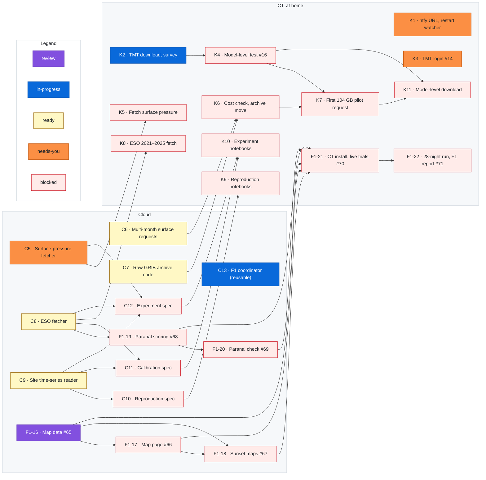

# Roadmap: status, work order and session prompts

**This is the single source for what runs next, where it runs, and the prompt that starts it.** It is a living document: every session updates it as it starts and finishes, following [`docs/agents/session-handoff.md`](agents/session-handoff.md). **It lists only unfinished work:** when an item's PR merges, its entry is deleted (D70). Status changes and those deletions are committed straight to `dev` (D67, D70); everything else changes through pull requests.

- Decisions live in `docs/decisions.md`. Finished work is there and in the merged PRs, the closed tickets and git history.
- Ticket discussions live in GitHub issues under the two maps:
  - [Map #6: the way to Gate 1](https://github.com/rrweller/Astro-seeing/issues/6) (historical track)
  - [Map #20: the way to F1](https://github.com/rrweller/Astro-seeing/issues/20) (forecast track)

## How to use it

1. Look at the **status board** below (or the colored diagram). Anything `ready` can start now. Items in the same wave can run at the same time.
2. Open the item's section under **Prompts**. Start a new cloud session on `rrweller/Astro-seeing` (`cloud` items) or a Claude Code session on CT 350 (`CT` items). Paste the whole prompt as your first message. Many prompts begin with a slash command such as `/mattpocock-skills:implement`. Keep it as the very first thing in the message: that's what starts the skill, and the rest of the prompt goes to it as its instructions.
3. The session marks the item `in-progress`, then `review` when its PR is open. After you merge the PR, it **deletes the item from this file** (board line, diagram node and arrows, table rows, prompt) and moves the items that were waiting only on it to `ready`. If a session ends early, the next session's sweep catches up.
4. `needs-you` means the item is waiting on you: a merge, a login, an approval, or being at home.

## Status board

Each line: ID · **state** · where it runs · item · tickets and PRs. Sessions edit only the state word and the link, or delete the whole entry once the item is finished, per `docs/agents/session-handoff.md`; the blank lines between entries are deliberate.

- `C5` · **needs-you** · cloud · Surface-pressure point fetcher for Haslebacher (b) · needs you: merge PR #94 · [#93](https://github.com/rrweller/Astro-seeing/issues/93) · PR [#94](https://github.com/rrweller/Astro-seeing/pull/94)

- `C6` · **ready** · cloud · Multi-month surface requests and per-kind planning rates · ticket: none yet

- `C7` · **ready** · cloud · Code to move the kept raw GRIB to the NAS · ticket: none yet

- `C8` · **ready** · cloud · ESO seeing-monitor fetcher · ticket: none yet

- `C9` · **ready** · cloud · Site time-series reader for the reproductions · ticket: none yet

- `C10` · **blocked** · cloud · Reproduction spec and CT tickets (needs your approval) · ticket: none yet

- `C11` · **blocked** · cloud · Calibration spec and CT tickets (needs your approval) · ticket: none yet

- `C12` · **blocked** · cloud · Experiment spec and CT tickets (needs your approval) · ticket: none yet

- `C13` · **in-progress** · cloud · F1 coordinator, reusable: one run takes up to 5 ready F1 cloud tickets (you answer questions) · next run: F1-15, F1-16 · ticket: none

- `F1-16` · **review** · cloud · Map data: ICON-EU map grid and map layers · [#65](https://github.com/rrweller/Astro-seeing/issues/65) · PR [#95](https://github.com/rrweller/Astro-seeing/pull/95)

- `F1-17` · **blocked** · cloud · The map page: layers, hour slider, cell card · [#66](https://github.com/rrweller/Astro-seeing/issues/66)

- `F1-18` · **blocked** · cloud · Sunset maps for the last 7 nights · [#67](https://github.com/rrweller/Astro-seeing/issues/67)

- `F1-19` · **blocked** · cloud · Paranal scoring: hourly ESO values, matched hours, statistics · waits also for C8's ticket · [#68](https://github.com/rrweller/Astro-seeing/issues/68)

- `F1-20` · **blocked** · cloud · Paranal check end to end: ESO fetch, nights, panel, weekly report · [#69](https://github.com/rrweller/Astro-seeing/issues/69)

- `F1-21` · **blocked** · CT · CT: install the service and page, live trials, alerts once · [#70](https://github.com/rrweller/Astro-seeing/issues/70)

- `F1-22` · **blocked** · CT · CT: the 28-night run, size report and reports/f1.md · [#71](https://github.com/rrweller/Astro-seeing/issues/71)

- `K1` · **needs-you** · CT · Recover the ntfy URL; pull `dev` and restart the notify watcher · needs you: be at home

- `K2` · **in-progress** · CT · TMT ERA5 download finishing (~28–29 Nov), then survey the stores · download running

- `K3` · **needs-you** · CT · TMT login · [#14](https://github.com/rrweller/Astro-seeing/issues/14)

- `K4` · **blocked** · CT · One model-level (ERA5 complete) test request · [#16](https://github.com/rrweller/Astro-seeing/issues/16)

- `K5` · **blocked** · CT · Fetch surface pressure at the 8 Haslebacher sites · ticket: none yet

- `K6` · **blocked** · CT · Surface-request cost check, then the raw GRIB archive move · ticket: none yet

- `K7` · **blocked** · CT · First pilot request: 1–16 June 2023, global, ~104 GB · ticket: none yet

- `K8` · **blocked** · CT · ESO DIMM/MASS fetch for 2021–2025 · ticket: none yet

- `K9` · **blocked** · CT · Reproduction notebooks, one per paper · ticket: none yet

- `K10` · **blocked** · CT · Experiment notebooks, one per experiment (C12 lists them) · ticket: none yet

- `K11` · **blocked** · CT · Model-level download, Paranal 2023 (~1.70 M fields, after K4 and your [ASK]) · ticket: none yet

## Dependency diagram

Colors show each item's state (legend at the bottom). The arrows show what has to finish first.



In the diagram, the class names are `review`, `inprogress`, `ready`, `needsyou` and `blocked`. There's no `done`: finished items are deleted. Mermaid class names can't contain hyphens, so `in-progress` is written `inprogress` and `needs-you` is written `needsyou`. Node IDs can't either, so item `F1-7` is the node `F1_7` (its edges and its `class F1_7 …` line).

## Work order

### Cloud waves

Items in a wave can run at the same time. A later wave usually depends on an earlier one, or is simply lower priority.

**F1 tickets (waves 4–9):** their "Touches" column and each ticket's "Can run alongside:" line show which can run at the same time; one-line additions to `cli.py` and the forecast config don't count as overlap. F1-1 to F1-3 are the first working slice (one forecast model, one place, the page shows data).

**Practical limit:** you can answer only one grilling session at a time. Coding sessions run on their own, but keep to about three at once so their PRs don't conflict much. The "Touches" column shows which ones overlap.

| Wave | ID | Needs you? | Touches |
|---|---|---|---|
| 1 | C5 | no | `download/`, `cli.py` |
| 1 | C8 | no | new module, `cli.py` |
| 1 | C9 | no | new module |
| 2 | C6 | no | `download/requests.py`, `configs/era5.yaml`, `cli.py` |
| 2 | C7 | no | `manifest.py`, `cli.py`, new module |
| 3 | C10 | yes: approve | issues, this file |
| 3 | C11 | yes: approve | issues, this file |
| 3 | C12 | yes: approve | issues, this file |
| 4+ | C13 | yes: answer the helpers' questions | runs the ready F1 cloud tickets, up to 5 per run (see their rows) |
| 7 | F1-16 | no | `forecast/` grid, publish (layers), tick |
| 8 | F1-17 | no | `web/forecast/` map, vendored MapLibre |
| 9 | F1-18 | no | `forecast/` publish (sunset), tick, `web/forecast/` map |
| 5 | F1-19 | no | `forecast/` paranal scoring |
| 8 | F1-20 | no | `forecast/` paranal, column (relocation), tick, `web/forecast/` Paranal panel, `cli.py` |

### CT order

Copernicus allows **one job at a time per account** (D39). So the items that use it run strictly one after another:

1. K2 (the TMT queue, running now);
2. K4;
3. K7;
4. K11 (only after your [ASK] on K4's numbers, D59).

F1-21 and F1-22 (the forecast's live trials and its 28-night run) don't use it either. Items that don't use that slot can run alongside them: K5 uses its own time-series slot, and K6's cost estimates submit nothing. K10's small fetches (the time-series product, GLO-30 tiles from AWS, ESO rows) don't use it either.

| ID | Depends on | Uses the CDS slot? |
|---|---|---|
| K1 | — | no |
| K2 | — | yes (running now) |
| K3 | — | no |
| K4 | K2 | **yes** |
| K5 | C5 | own slot |
| K6 | C6, C7 | estimates only |
| K7 | K4, K6 | **yes** |
| K8 | C8 | no |
| K9 | C10, C9 | no |
| K10 | C12, C11 (stage 1, for the ground-layer part) | no (time-series slot, AWS, ESO only) |
| K11 | K4, K7, and your [ASK] on the size | **yes** |
| F1-21 | F1-16 to F1-20 | no |
| F1-22 | F1-21 | no |

## Reserved D-numbers

Parallel sessions would otherwise take the same number.

| D-number | Item |
|---|---|
| D61 | C10 |
| D62 | C5 |
| D63 | C6 |
| D64 | C7 |
| D65 | C8 |
| D66 | C9 |
| D68 | C11 |
| D69 | C12 |
| D94 | C13 |
| D86–D92 | F1-16 to F1-22, in order (F1-n takes D70+n) |

- D67 is this roadmap process; D70 is deleting finished items; D93 is agents merging into `dev` and the coordinator.
- When an item is deleted, its row here goes too: its number is then on `dev`.
- A session needing more than one number adds letters (D62a, D62b, …).
- New items take the next free number after the highest on `dev`, in open PRs, and in this table, and add it to this table in their PR.

---

## Prompts

Every prompt has the same first sentence, which loads the session protocol. Most put a slash command in front of it on the same line, which starts that item's main skill. Copy everything inside the box and send it as one message. If a session ever shows the skill without the rest of the prompt (it shouldn't), send the prompt again without the slash command as the next message.

### C5. Surface-pressure point fetcher for Haslebacher (b)

```text
/mattpocock-skills:implement Read docs/agents/session-handoff.md on origin/dev first and follow it for this whole session. Your roadmap item is C5.

Skills: this message starts implement, and this prompt is its spec. Build test-first with mattpocock-skills:tdd, then run mattpocock-skills:code-review on your branch against origin/dev before opening the PR, and fix what it finds. Implement ends with a commit; this item still ends with the PR and status steps below.

You are a cloud session on rrweller/Astro-seeing (no /data, CDS or CT access). Work from origin/dev. Read AGENTS.md, CLAUDE.md, docs/agents/issue-tracker.md, docs/RESEARCH.md §3.4 and §7 (the single-level time-series product), and decisions D2, D25, D29, D39 and D57 item 4 (if D57 isn't on dev, read it from branch grill/7-reproductions, PR #39).

Task: build a minimal point fetcher for the CDS product reanalysis-era5-single-levels-timeseries that gets surface pressure (sp) at given points for 1979–2020 (D57 item 4). First create a ticket under map #6 (labels runs-on:cloud, wayfinder:task), unless one exists, claim it, and put its link on your roadmap board line.

Requirements:
- Use the existing ecmwf-datastores client pattern (D2) and the manifest, so requests are tracked and resumable.
- The product has its own CDS slot (D29). Its jobs are recorded, but never counted by or blocking the pressure-level gate (D39).
- Chunk by year if a request limit bites; the chunk size is configurable, because the 42-year single request is untested.
- Verify the returned NetCDF: variable, point, time coverage, no gaps or NaN (count and log any).
- Write atomically as a small per-site store under a path from config.
- Add a CLI command and tests against tests/fakes.py, covering a resubmitted lost job, a partial year, and a verification failure.
- Use the 8 Haslebacher sites' nearest grid points from configs/sites.yaml.

Don't contact the CDS from this session. Log non-trivial choices as D62. Run the full test suite and ruff, then open a PR into dev with the exact CT commands for Riley.
```

### C6. Multi-month surface requests and per-kind planning rates

```text
/mattpocock-skills:implement Read docs/agents/session-handoff.md on origin/dev first and follow it for this whole session. Your roadmap item is C6.

Skills: this message starts implement, and this prompt is its spec. Build test-first with mattpocock-skills:tdd, then run mattpocock-skills:code-review on your branch against origin/dev before opening the PR, and fix what it finds. Implement ends with a commit; this item still ends with the PR and status steps below.

You are a cloud session on rrweller/Astro-seeing (no /data, CDS or CT access). Work from origin/dev. Read AGENTS.md, CLAUDE.md, docs/agents/issue-tracker.md, reports/cds_throughput_one_job.md, and decisions D16, D23, D39, D40 and D55 (if D55 isn't on dev, read it from branch grill/13-global-downloads, PR #37).

Task (D55 item 5, plus the config fix in cds_throughput_one_job.md §5). First create a ticket under map #6 (runs-on:cloud, wayfinder:task), unless one exists, claim it, and put its link on your roadmap board line.

1. Let single-level requests span up to N consecutive months (configurable, default 3, per D55) in src/astroseeing/download/requests.py; RequestSpec.cds_request allows one month today.
   - A months × days request implies dates that don't exist (30 Feb, 31 Apr), and verification must expect exactly the real dates.
   - Planning refuses anything over the configured cost limit before queuing.
   - Labels and store paths stay unique.
2. Add a command (or flag) that prices a plan with the CDS cost estimator without submitting it, printing the estimate next to our own field count, so Riley can run the "does the CDS count 30 February?" check on the CT.
3. Replace the single request.fields_per_s in configs/era5.yaml with per-kind planning rates from the report, or better, the per-request wait-plus-run model (W + F/R, §5). Update the estimate plan-area prints.

Pressure-level requests stay unchanged. Tests: month boundaries, leap years, non-existent dates, cost limit, unique keys, estimates. Log non-trivial choices as D63. Run the full test suite and ruff, then open a PR into dev with the CT commands for the cost check.
```

### C7. Code to move the kept raw GRIB from `/staging` to the NAS

```text
/mattpocock-skills:implement Read docs/agents/session-handoff.md on origin/dev first and follow it for this whole session. Your roadmap item is C7.

Skills: this message starts implement, and this prompt is its spec. Implement ends with a commit; this item still ends with the PR and status steps below. Build test-first with mattpocock-skills:tdd (write the crash-recovery and hung-filesystem tests first), then run mattpocock-skills:code-review on your branch against origin/dev before opening the PR, and fix what it finds. This code deletes files, so take the review seriously.

You are a cloud session on rrweller/Astro-seeing (no /data, CDS or CT access). Work from origin/dev. Read AGENTS.md in full (data-safety rules), CLAUDE.md, docs/agents/issue-tracker.md, and decisions D10, D11, D12, D50 and D55 items 6–7 (if D55 isn't on dev, read it from branch grill/13-global-downloads, PR #37).

Task: build the command that copies the raw validation GRIB kept on /staging (~41 GB, 472 files, plus the 271 MB measurement file) to a write-once archive on the NAS, then removes the /staging copies. First create a ticket under map #6 (runs-on:cloud, wayfinder:task), unless one exists, claim it, and put its link on your roadmap board line.

Rules:
- The archive path comes from config (D55 suggests /data/astro/raw-archive; propose the exact layout).
- Order of operations: copy, fsync, verify the SHA-256 against the manifest's recorded checksum, record the archive location in the manifest, and only then delete the /staging copy. Mirror D12's ordering and crash recovery.
- Never overwrite or delete anything under /data. A destination with different content is refused; an identical one is a no-op.
- Add a dry-run mode that prints sizes and the plan.
- NFS hangs rather than failing (AGENTS.md), so use per-file timeouts and a watchdog.
- Make it resumable after interruption.
- Measurement-only files (state "measured") are listed separately, because deleting them is Riley's call.

Tests with temp directories and a fake slow or hung filesystem. Log non-trivial choices as D64. Run the full test suite and ruff, then open a PR into dev with the exact CT commands (dry run first).
```

### C8. ESO seeing-monitor fetcher

```text
/mattpocock-skills:implement Read docs/agents/session-handoff.md on origin/dev first and follow it for this whole session. Your roadmap item is C8.

Skills: this message starts implement, and this prompt is its spec. Build test-first with mattpocock-skills:tdd, then run mattpocock-skills:code-review on your branch against origin/dev before opening the PR, and fix what it finds. Implement ends with a commit; this item still ends with the PR and status steps below.

You are a cloud session on rrweller/Astro-seeing (no /data, CDS or CT access). Work from origin/dev. Read AGENTS.md, CLAUDE.md, docs/agents/issue-tracker.md, docs/RESEARCH.md §6.5, decisions D28, D44 and D54 item 8 (if D54 isn't on dev, read it from branch planning/paranal-comparison-d54, PR #38), and docs/research/seeing-measurements.md on branch research/seeing-measurements (ESO query details).

Task: one fetcher for ESO's ambient-conditions archive, shared by the forecast track (nightly, D54 item 8) and the historical calibration (2021–2025 bulk). First create a ticket under map #20 (runs-on:cloud, wayfinder:task), unless one exists, claim it, and put its link on your roadmap board line. Then edit F1 ticket #68 (Paranal scoring) so its Blocked by line names your ticket number instead of "roadmap item C8".

Requirements:
- Data: Paranal DIMM and MASS (including free-atmosphere seeing, turbulence altitude and ground fraction), and La Silla DIMM.
- Query by UTC time range. Use a generic User-Agent with no contact details. In bulk mode, send at most one request every few seconds, chunked by month.
- Write raw CSV write-once under a configured path (D54: /data/astro/validation/eso-asm/), with fetch time and SHA-256, recorded in the manifest.
- A re-fetch of the same night is a separate, named file (D54's 3-day re-fetch). Never overwrite.
- Parse into a typed table. Count and log rows dropped as missing or non-numeric; never clip.

If this session can reach archive.eso.org, save one small real response as a test fixture (CC BY 4.0; note the ESO acknowledgement) and check the column names against it. Otherwise build from the documented columns and say so in the PR. Tests: parsing, write-once, re-fetch naming, retries. Log choices as D65. Run the full test suite and ruff, then open a PR into dev with the CT commands for the 2021–2025 bulk fetch.
```

### C9. Site time-series reader for the reproductions

```text
/mattpocock-skills:implement Read docs/agents/session-handoff.md on origin/dev first and follow it for this whole session. Your roadmap item is C9.

Skills: this message starts implement, and this prompt is its spec. Implement ends with a commit; this item still ends with the PR and status steps below. Before any code, design the reader's interface and test seams with mattpocock-skills:codebase-design (one deep module the four notebooks call). Then build it with mattpocock-skills:tdd at those seams, and run mattpocock-skills:code-review on your branch against origin/dev before opening the PR, and fix what it finds.

You are a cloud session on rrweller/Astro-seeing (no /data, CDS or CT access). Work from origin/dev. Read AGENTS.md, CLAUDE.md, CONTEXT.md, docs/agents/issue-tracker.md, docs/RESEARCH.md in full, decisions D3, D5, D8, D10, D18 and D57 (if D57 isn't on dev, read it from branch grill/7-reproductions, PR #39), and reports/validation_downloads.md §1 (store layouts: grid, and area cells).

Task: the shared, tested code the four paper reproductions will call on the CT. Map #6 says the cloud writes this against synthetic stores. First create a ticket under map #6 (runs-on:cloud, wayfinder:task), unless one exists, claim it, and put its link on your roadmap board line.

1. Read a site's hourly columns (z, t, u, v, and cc when present) from one or many Zarr stores in either layout, over a time range, in time order, with checks for duplicate or missing hours.
2. Site-value rules (D57 item 2):
   - nearest grid point;
   - four-point bilinear (O&S);
   - Priyatikanto's cubic interpolation in lon, lat and pressure, then linear to 5 hPa steps.
   Interpolating T, u, v and z is allowed inside reproductions; interpolating seeing or J is not.
3. Underground-level masking by the cell's static orography (D57 item 1), plus the unmasked variant. Masked counts are returned, not just logged.
4. Hour-set selectors (D57 item 3), using the existing solar module:
   - all hours;
   - night mask (Sun < −12°);
   - dark time (Sun < −18°) over a given list of nights;
   - local-solar-time windows (04–07 h, 19–23 h).
5. Golden-result JSON helpers (D57 item 5: settings, store ids and content hashes, statistics, target, tolerance, gating vs informational), and a pytest marker `data` that skips when /data is absent.

Build synthetic test stores with the existing synthetic helpers. Known-answer tests for each interpolation; property tests where they fit. Log choices as D66. Run the full test suite and ruff, then open a PR into dev.
```

### C10. Reproduction spec and CT tickets

Needs your approval. Once you've approved the spec, the session asks you to send `/mattpocock-skills:to-tickets #<spec issue>` as your next message. Depends on C9.

```text
/mattpocock-skills:to-spec Read docs/agents/session-handoff.md on origin/dev first and follow it for this whole session. Your roadmap item is C10.

Skills: this message starts to-spec. Write the reproduction spec in its template and check its seams with Riley. A session can't start to-tickets itself, so once Riley approves the spec, ask Riley to send "/mattpocock-skills:to-tickets #<spec issue number>" as the next message. Then cut the tickets with it, using the extra ticket lines below. Use mattpocock-skills:grilling for the open question about missed tolerances, mattpocock-skills:domain-modeling for terms and the decision entry, and mattpocock-skills:writing-for-agents when writing the per-ticket prompts for docs/roadmap.md.

You are a cloud session on rrweller/Astro-seeing. Work from origin/dev. Read:
- AGENTS.md, CLAUDE.md, CONTEXT.md, docs/agents/issue-tracker.md, docs/roadmap.md, docs/RESEARCH.md in full;
- decisions D19, D27, D28, D35, D57, D58 and D59;
- the research notes on branches research/os2018-nights and research/bi2023-altitudes;
- the merged code from roadmap items C9 (site reader) and C5 (surface-pressure fetcher).

Task: write the reproduction spec as an issue under map #6, then its tickets (follow docs/agents/issue-tracker.md).
- Create one runs-on:ct ticket per paper, in D57's order: Haslebacher (a) Paranal, Priyatikanto, Bi, O&S. Add Haslebacher (b) (Table 4 levels) and Haslebacher (c) (the written account).
- Each ticket states:
  - the variant grid fixed before running;
  - the gating variant and its tolerance (D19);
  - the input store ids;
  - the outputs: notebook, reports/repro_<paper>.md, golden JSON;
  - "Suggested skills: start with /mattpocock-skills:implement; mattpocock-skills:diagnosing-bugs if a result misses its tolerance; mattpocock-skills:research for the written account".
- Reuse existing tickets rather than duplicating them.
- Include what happens when a reproduction misses its tolerance, as an open question for Riley with a recommendation (map #6 lists it as unspecified).

Show Riley the outline and ticket list for approval (C10 to needs-you while you wait). Record decisions as D61. In a PR into dev, replace roadmap item K9 with one item per ticket (K9a, K9b, …), each with a board line, diagram node, edges, a class line followed by a %% --- spacer, and a short prompt. The prompt starts with "/mattpocock-skills:implement" followed on the same line by this prompt's standard first sentence (with the new ID), then has a "Skills:" line.

The Blocked by line in each ticket body is the source of truth (docs/agents/issue-tracker.md). Don't close or change map #6 except to add the spec and tickets as sub-issues.
```

### C11. Calibration spec and CT tickets

Needs your approval. Like C10: the prompt starts with `/mattpocock-skills:to-spec`, and once you've approved the spec, the session asks you to send `/mattpocock-skills:to-tickets #<spec issue>` as your next message. Depends on C8 (the ESO fetcher the data comes from) and C9 (the site reader the matching code uses).

```text
/mattpocock-skills:to-spec Read docs/agents/session-handoff.md on origin/dev first and follow it for this whole session. Your roadmap item is C11.

Skills: this message starts to-spec. Write the calibration spec in its template and check its seams with Riley. A session can't start to-tickets itself, so once Riley approves the spec, ask Riley to send "/mattpocock-skills:to-tickets #<spec issue number>" as the next message. Use mattpocock-skills:codebase-design for the fit module's interface, mattpocock-skills:domain-modeling for terms (CONTEXT.md: Fit set, Held-out set, Freeze, Matched hour, MASS seeing, Ground-layer term) and the decision entry, and mattpocock-skills:writing-for-agents for the per-ticket prompts.

You are a cloud session on rrweller/Astro-seeing. Work from origin/dev. Read AGENTS.md, CLAUDE.md, CONTEXT.md, docs/agents/issue-tracker.md, docs/roadmap.md and docs/RESEARCH.md in full; decisions D19, D54, D57, D58 and D59; src/astroseeing/physics/calibration.py; and the merged code from C8 (ESO fetcher) and C9 (site reader).

Task: write the calibration spec (D58) as an issue under map #6, then its tickets (follow docs/agents/issue-tracker.md). At least:
- a runs-on:cloud ticket for the matching code (D58 item 6: hour medians, matched hours, nightly medians, counts and reasons), against synthetic data;
- a runs-on:cloud ticket for the committed split file and the fit (items 4–5: equal-site-weight zero-bias root find, G >= 0 logged, 7-night block bootstrap, the refusal of held-out nights with its unit test);
- a runs-on:ct ticket for the TMT fetcher and first-data checks (cadence, time standard, normalisation, instrument heights; the 20% rule), blocked by #14;
- runs-on:ct tickets for the stage-1 fit, the stage-2 fits per ground-layer option with cross-validation (shared with #17's ground-layer experiment; reuse its ticket if one exists), and the single held-out run after the freeze, which is blocked by the four reproduction tickets and by Riley's ground-layer [ASK];
- reports/calibration.md's contents (item 8's gated checks and reported statistics).

Show Riley the outline and ticket list for approval (C11 to needs-you while you wait). Record any decisions as D68. In a PR into dev, add one roadmap item per CT ticket (next free K numbers), each with a board line, diagram node, edges, a class line followed by a %% --- spacer, and a short prompt starting with "/mattpocock-skills:implement" followed on the same line by this prompt's standard first sentence (with the new ID), then a "Skills:" line.

The Blocked by line in each ticket body is the source of truth (docs/agents/issue-tracker.md). Don't close or change map #6 except to add the spec and tickets as sub-issues.
```

### C12. Experiment spec and CT tickets

Needs your approval. Like C10 and C11: the prompt starts with `/mattpocock-skills:to-spec`, and once you've approved the spec, the session asks you to send `/mattpocock-skills:to-tickets #<spec issue>` as your next message. Depends on C5 and C8 (the fetchers its tickets extend) and C9 (the site reader every experiment uses).

```text
/mattpocock-skills:to-spec Read docs/agents/session-handoff.md on origin/dev first and follow it for this whole session. Your roadmap item is C12.

Skills: this message starts to-spec. Write the experiment spec in its template and check its seams with Riley. A session can't start to-tickets itself, so once Riley approves the spec, ask Riley to send "/mattpocock-skills:to-tickets #<spec issue number>" as the next message. Use mattpocock-skills:codebase-design for the new fetchers' interfaces, mattpocock-skills:domain-modeling for terms (CONTEXT.md: Switch rule, Overlap rule) and the decision entry, and mattpocock-skills:writing-for-agents for the per-ticket prompts.

You are a cloud session on rrweller/Astro-seeing. Work from origin/dev. Read AGENTS.md, CLAUDE.md, CONTEXT.md, docs/agents/issue-tracker.md, docs/roadmap.md and docs/RESEARCH.md in full; decisions D5, D6, D7, D19, D57, D58 and D59; src/astroseeing/physics/ (cloud.py, groundlayer.py, integrate.py); and the merged code from C5 (point fetcher), C8 (ESO fetcher) and C9 (site reader).

Task: write the spec for the five experiments of D59 as an issue under map #6, then its tickets (follow docs/agents/issue-tracker.md). Each experiment's ticket states D59's sites, periods, metric and switch rule, its input store ids, and its outputs (notebook, reports/exp_<name>.md). At least:
- runs-on:cloud: extend C5's point fetcher from sp to sp, 2t and tcc (D59 item 5), against a fake backend, with tests;
- runs-on:cloud: a GLO-30 tile fetcher for a list of sites (public AWS bucket, anonymous; checksums; missing-tile check; RESEARCH §7), with tests;
- runs-on:cloud: the exponential-random overlap rule with a decorrelation length, added to physics/cloud.py with known-answer and property tests (D59 item 6);
- runs-on:ct: fetch sp, 2t, tcc at the Chile sites 2021–2025 (time-series slot); fetch the GLO-30 tiles;
- runs-on:ct: ESO LHATPRO IR rows for 2021, 2023, 2025 and the clear/cloudy flag research step (it must reproduce Kerber et al. 2014's ~60% cloud-free nights first);
- runs-on:ct, one per experiment: D6 overlap check; hourly vs 3-hourly; terrain-aware vs cell average; ground layer (shared with C11's stage-2 ticket: reuse it if it exists, never duplicate); cloud above height vs observations; pressure vs model levels (blocked by K11).
Put D59 item 8's order into the Blocked by lines.

Show Riley the outline and ticket list for approval (C12 to needs-you while you wait). Record any decisions as D69. In a PR into dev, replace roadmap item K10 with one item per CT ticket (K10a, K10b, …), each with a board line, diagram node, edges, a class line followed by a %% --- spacer, and a short prompt starting with "/mattpocock-skills:implement" followed on the same line by this prompt's standard first sentence (with the new ID), then a "Skills:" line. Add the cloud tickets as cloud roadmap items (next free C numbers) the same way.

The Blocked by line in each ticket body is the source of truth (docs/agents/issue-tracker.md). Don't close or change map #6 except to add the spec and tickets as sub-issues.
```

### C13. F1 coordinator (reusable)

Paste this prompt into a new chat each time C13 is `ready`. One run takes the F1 cloud tickets that are ready, up to 5, each with its own helper agent, and you answer the helpers' questions in that one chat. It merges each PR itself under D93 and keeps the roadmap current. At the end it sets C13 up for the next run (`ready`, naming the tickets), sets it `blocked` with the reason, or deletes it when no F1 cloud tickets are left. Tickets it can't run (the two CT tickets, or one waiting on something outside F1) it names, so you can start them with their own prompts. It has no slash command, because a coordinator can't pass one on (D93); each helper loads the tdd and code-review skills itself.

```text
Read docs/agents/session-handoff.md on origin/dev first and follow it for this whole session. Your roadmap item is C13.

Skills: you coordinate and write no feature code yourself. Each helper agent loads mattpocock-skills:tdd and mattpocock-skills:code-review with its own Skill tool (the helper brief below says so). The implement skill can't be loaded by an agent; tdd, then code-review, then commit is the same work.

You are a cloud session on rrweller/Astro-seeing (no /data, CDS or CT access), coordinating one run of F1 build tickets. Work from origin/dev. Read AGENTS.md, CLAUDE.md, CONTEXT.md, docs/agents/issue-tracker.md, docs/roadmap.md, the F1 spec #47, and D93 in docs/decisions.md. If pixi is missing, install it (curl -fsSL https://pixi.sh/install.sh | sh), then run pixi install --locked. Riley allows this session and its helpers to push one new branch per ticket and the handoff's direct commits to dev, whatever branch the session was given.

The run: the frontier is every F1 item with `runs-on:cloud` whose roadmap state is `ready` and whose ticket's Blocked by line has only closed issues (a line naming a roadmap item in words, like F1-19's "roadmap item C8", waits until that item is gone from the roadmap). Take tickets from the frontier in roadmap order, at most 3 helpers at once, up to 5 tickets per run; a merge may add new tickets to the frontier mid-run. Claim C13 at the start (ready → in-progress).

For each ticket you take:
1. Claim it: the roadmap status commit (<ID> ready → in-progress) and the ticket claim in docs/agents/issue-tracker.md.
2. Start one helper with the Agent tool: subagent_type general-purpose, run_in_background true, isolation "worktree", with the helper brief below filled in.
3. A helper that returns a question for Riley: put it to Riley here in plain language (CLAUDE.md, "Asking Riley questions"), naming the ticket, and pass his answer back with SendMessage. Riley answers; you relay.
4. A helper that returns a PR: status commit <ID> in-progress → review with the PR link, and subscribe to the PR. Merge it yourself (you're authorized under D93) once every condition in docs/agents/session-handoff.md "Merging into dev" holds. A red check or a serious review finding goes back to that helper with SendMessage; once fixed, re-check.
5. After each merge: close the ticket with a comment linking the PR, delete the item from the roadmap and sweep (the handoff), tell Riley in one line what merged, then fill free helper slots from the frontier until the run has taken 5 tickets.

Helper brief (fill in <ID>, <N>, <D>; F1-n's D-number is D70+n):
"You implement roadmap item <ID>, ticket #<N>, on rrweller/Astro-seeing, in your own worktree on a new branch from origin/dev. Read AGENTS.md, CLAUDE.md, CONTEXT.md, docs/agents/issue-tracker.md, ticket #<N> with its comments, the F1 spec #47, and the decisions and research notes the ticket names. First load mattpocock-skills:tdd with your Skill tool and build test-first at the ticket's seams. Run single test files as you go, and pixi run lint and pixi run test at the end. Then load mattpocock-skills:code-review, review your branch against origin/dev, and fix what it finds. Load any other skill the ticket's Suggested skills line names that your Skill tool offers. Log non-trivial choices as <D>. Commit, push the branch, and open a PR into dev: the description says it completes <ID> and closes #<N>, marks each acceptance criterion met or not (with why), and lists the review's findings and what you did about each. Leave docs/roadmap.md, the ticket's state and the merge to the coordinator. A choice that belongs to Riley (an ambiguous rule, an [ASK] in AGENTS.md, anything the ticket says to ask) ends your turn: return the question with the options and your recommendation. Return: the PR number, the lint and test results, review findings fixed and left open, and any question."

Pacing: helpers notify you when they finish, and PR events (the check, reviews) wake you. While a helper runs and nothing else is pending, keep one send_later check-in about every 30 min.

The run is done when its tickets are merged, closed and gone from the roadmap (or a blocker only Riley can clear is stated), and no helper is still running. Then set up the next run with one status commit to dev:
- F1 cloud tickets are on the frontier now: C13 → ready, with "next run: <IDs>" on its board line;
- F1 cloud tickets remain, but none is on the frontier: C13 → blocked, with "waits for: <what each needs>" on its board line;
- no F1 cloud tickets remain: delete C13 per the handoff ("roadmap: remove C13 (finished: F1 cloud tickets merged)").
Report to Riley here:
- each PR and what it delivered, and anything left open;
- screenshots from any page ticket;
- what the next run will take, or why there's no next run yet;
- for every F1 ticket a coordinator can't run (runs-on:ct, or waiting on something outside F1), tell Riley to start it in its own chat with its roadmap prompt once its wait is over, naming the ticket and the wait.
Then clean up the helpers' worktrees.
```

### F1-16. Map data: ICON-EU map grid and map layers

Ticket [#65](https://github.com/rrweller/Astro-seeing/issues/65). The coordinator (C13) can run this ticket; paste this prompt yourself only when it can't, or you'd rather run it alone.

```text
/mattpocock-skills:implement Read docs/agents/session-handoff.md on origin/dev first and follow it for this whole session. Your roadmap item is F1-16.

Skills: this message starts implement, and ticket #65 is its spec. Build test-first with mattpocock-skills:tdd, then run mattpocock-skills:code-review on your branch against origin/dev before opening the PR, and fix what it finds. Use any other skill the ticket's "Suggested skills:" line names. Implement ends with a commit; this item still ends with the PR and status steps.

You are a cloud session on rrweller/Astro-seeing (no /data, CDS or CT access). Work from origin/dev. Read AGENTS.md, CLAUDE.md, CONTEXT.md, docs/agents/issue-tracker.md, the F1 spec #47, and the decisions ticket #65 names.

Task: work ticket #65. Claim it as docs/agents/issue-tracker.md describes. Its acceptance criteria are the bar: every box ticked, or the gap stated in the PR. Log non-trivial choices as D86 (reserved for this item; add letters for more). Run the full test suite and ruff, then open a PR into dev that closes #65. You may merge it yourself (D93): once the `tests` check is green on its head commit and code review left nothing serious, squash-merge it into dev, close ticket #65 with a comment linking the PR, and do the handoff's after-merge steps.
```

### F1-17. The map page: layers, hour slider, cell card

Ticket [#66](https://github.com/rrweller/Astro-seeing/issues/66). Depends on F1-16. The coordinator (C13) can run this ticket; paste this prompt yourself only when it can't, or you'd rather run it alone.

```text
/mattpocock-skills:implement Read docs/agents/session-handoff.md on origin/dev first and follow it for this whole session. Your roadmap item is F1-17.

Skills: this message starts implement, and ticket #66 is its spec. Build test-first with mattpocock-skills:tdd, then run mattpocock-skills:code-review on your branch against origin/dev before opening the PR, and fix what it finds. Use any other skill the ticket's "Suggested skills:" line names. Implement ends with a commit; this item still ends with the PR and status steps.

You are a cloud session on rrweller/Astro-seeing (no /data, CDS or CT access). Work from origin/dev. Read AGENTS.md, CLAUDE.md, CONTEXT.md, docs/agents/issue-tracker.md, the F1 spec #47, and the decisions ticket #66 names. Also read web/prototype-globe-library/ on branch prototype/globe-library (throwaway; for the addProtocol nearest-block technique).

Task: work ticket #66. Claim it as docs/agents/issue-tracker.md describes. Its acceptance criteria are the bar: every box ticked, or the gap stated in the PR. Log non-trivial choices as D87 (reserved for this item; add letters for more). Run the full test suite and ruff, then open a PR into dev that closes #66. You may merge it yourself (D93): once the `tests` check is green on its head commit and code review left nothing serious, squash-merge it into dev, close ticket #66 with a comment linking the PR, and do the handoff's after-merge steps.
```

### F1-18. Sunset maps for the last 7 nights

Ticket [#67](https://github.com/rrweller/Astro-seeing/issues/67). Depends on F1-16, F1-17. The coordinator (C13) can run this ticket; paste this prompt yourself only when it can't, or you'd rather run it alone.

```text
/mattpocock-skills:implement Read docs/agents/session-handoff.md on origin/dev first and follow it for this whole session. Your roadmap item is F1-18.

Skills: this message starts implement, and ticket #67 is its spec. Build test-first with mattpocock-skills:tdd, then run mattpocock-skills:code-review on your branch against origin/dev before opening the PR, and fix what it finds. Use any other skill the ticket's "Suggested skills:" line names. Implement ends with a commit; this item still ends with the PR and status steps.

You are a cloud session on rrweller/Astro-seeing (no /data, CDS or CT access). Work from origin/dev. Read AGENTS.md, CLAUDE.md, CONTEXT.md, docs/agents/issue-tracker.md, the F1 spec #47, and the decisions ticket #67 names.

Task: work ticket #67. Claim it as docs/agents/issue-tracker.md describes. Its acceptance criteria are the bar: every box ticked, or the gap stated in the PR. Log non-trivial choices as D88 (reserved for this item; add letters for more). Run the full test suite and ruff, then open a PR into dev that closes #67. You may merge it yourself (D93): once the `tests` check is green on its head commit and code review left nothing serious, squash-merge it into dev, close ticket #67 with a comment linking the PR, and do the handoff's after-merge steps.
```

### F1-19. Paranal scoring: hourly ESO values, matched hours, statistics

Ticket [#68](https://github.com/rrweller/Astro-seeing/issues/68). Depends on C8. C8's ticket isn't created yet; the ticket's Blocked by line names C8 until it is. The coordinator (C13) can run this ticket; paste this prompt yourself only when it can't, or you'd rather run it alone.

```text
/mattpocock-skills:implement Read docs/agents/session-handoff.md on origin/dev first and follow it for this whole session. Your roadmap item is F1-19.

Skills: this message starts implement, and ticket #68 is its spec. Build test-first with mattpocock-skills:tdd, then run mattpocock-skills:code-review on your branch against origin/dev before opening the PR, and fix what it finds. Use any other skill the ticket's "Suggested skills:" line names. Implement ends with a commit; this item still ends with the PR and status steps.

You are a cloud session on rrweller/Astro-seeing (no /data, CDS or CT access). Work from origin/dev. Read AGENTS.md, CLAUDE.md, CONTEXT.md, docs/agents/issue-tracker.md, the F1 spec #47, and the decisions ticket #68 names. Also read the merged ESO fetcher from roadmap item C8.

Task: work ticket #68. Claim it as docs/agents/issue-tracker.md describes. Its acceptance criteria are the bar: every box ticked, or the gap stated in the PR. Log non-trivial choices as D89 (reserved for this item; add letters for more). Run the full test suite and ruff, then open a PR into dev that closes #68. You may merge it yourself (D93): once the `tests` check is green on its head commit and code review left nothing serious, squash-merge it into dev, close ticket #68 with a comment linking the PR, and do the handoff's after-merge steps.
```

### F1-20. Paranal check end to end: ESO fetch, nights, panel, weekly report

Ticket [#69](https://github.com/rrweller/Astro-seeing/issues/69). Depends on F1-19. The coordinator (C13) can run this ticket; paste this prompt yourself only when it can't, or you'd rather run it alone.

```text
/mattpocock-skills:implement Read docs/agents/session-handoff.md on origin/dev first and follow it for this whole session. Your roadmap item is F1-20.

Skills: this message starts implement, and ticket #69 is its spec. Build test-first with mattpocock-skills:tdd, then run mattpocock-skills:code-review on your branch against origin/dev before opening the PR, and fix what it finds. Use any other skill the ticket's "Suggested skills:" line names. Implement ends with a commit; this item still ends with the PR and status steps.

You are a cloud session on rrweller/Astro-seeing (no /data, CDS or CT access). Work from origin/dev. Read AGENTS.md, CLAUDE.md, CONTEXT.md, docs/agents/issue-tracker.md, the F1 spec #47, and the decisions ticket #69 names. Also read the merged ESO fetcher from roadmap item C8.

Task: work ticket #69. Claim it as docs/agents/issue-tracker.md describes. Its acceptance criteria are the bar: every box ticked, or the gap stated in the PR. Log non-trivial choices as D90 (reserved for this item; add letters for more). Run the full test suite and ruff, then open a PR into dev that closes #69. You may merge it yourself (D93): once the `tests` check is green on its head commit and code review left nothing serious, squash-merge it into dev, close ticket #69 with a comment linking the PR, and do the handoff's after-merge steps.
```

### F1-21. CT: install the service and page, live trials, alerts once

Ticket [#70](https://github.com/rrweller/Astro-seeing/issues/70). Depends on F1-16, F1-17, F1-18, F1-19, F1-20.

```text
Read docs/agents/session-handoff.md on origin/dev first and follow it for this whole session. Your roadmap item is F1-21.

You are a Claude Code session on CT 350 (/home/astro-seeing), with /data, /staging, the manifest and CDS access. Read AGENTS.md, CLAUDE.md, docs/ct_runbook.md, docs/agents/issue-tracker.md and the F1 spec #47. Run git fetch origin and check out dev at origin/dev. Check `pixi run astro status` and `systemctl status astro-boxes`: the historical downloads keep running, at most 5 worker processes in total, and nothing may bypass the one-CDS-job gate (D39).

Skills: mattpocock-skills:wizard for Riley's Nginx Proxy Manager step; mattpocock-skills:diagnosing-bugs if a live trial fails.

Task: work ticket #70. Claim it as docs/agents/issue-tracker.md describes. Follow its acceptance criteria. Data-safety rules apply in full:
- never overwrite or delete under /data without asking Riley;
- verify before deleting raw files;
- write the reports the ticket names, with the numbers and what is uncertain;
- log non-trivial decisions as D91 (reserved for this item).
Set this item to needs-you while Riley sets up the proxy host. Open a PR into dev when done.
```

### F1-22. CT: the 28-night run, size report and reports/f1.md

Ticket [#71](https://github.com/rrweller/Astro-seeing/issues/71). Depends on F1-21.

```text
Read docs/agents/session-handoff.md on origin/dev first and follow it for this whole session. Your roadmap item is F1-22.

You are a Claude Code session on CT 350 (/home/astro-seeing), with /data, /staging, the manifest and CDS access. Read AGENTS.md, CLAUDE.md, docs/ct_runbook.md, docs/agents/issue-tracker.md and the F1 spec #47. Run git fetch origin and check out dev at origin/dev. Check `pixi run astro status` and `systemctl status astro-boxes`: the historical downloads keep running, at most 5 worker processes in total, and nothing may bypass the one-CDS-job gate (D39).

Skills: mattpocock-skills:research for writing up the measured numbers; mattpocock-skills:diagnosing-bugs if a statistic looks wrong.

Task: work ticket #71. Claim it as docs/agents/issue-tracker.md describes. Follow its acceptance criteria. Data-safety rules apply in full:
- never overwrite or delete under /data without asking Riley;
- verify before deleting raw files;
- write the reports the ticket names, with the numbers and what is uncertain;
- log non-trivial decisions as D92 (reserved for this item).
This item stays in-progress for the whole run (about 4 weeks). Open a PR into dev when done.
```

### CT prompt template (K2, K4–K11)

Replace `<ID>`, the skills line and the task line. Replace `<slash command>` with `/mattpocock-skills:implement` for K9's and K10's tickets, and delete it for the other items.

Skills by item: K1 and K3 `mattpocock-skills:wizard` (a step-by-step script for you); K4, K7 and K11 `mattpocock-skills:research` (write up what was measured); K9 also `mattpocock-skills:diagnosing-bugs` when a reproduction misses its tolerance, and K10 `mattpocock-skills:research` for the LHATPRO clear flag; the others none. Whether the Matt Pocock plugin is installed on the CT hasn't been checked: if a slash command answers "unknown command" there, it needs installing.

K11's task line: "Roadmap item K11, D59 item 2: the model-level (ERA5 complete) download for the Paranal 5×5 box, 2023, 23–11 UTC, levels 49–137 of t, q, u, v plus lnsp and z on level 1. Before planning anything, check that Riley has approved the size in an [ASK] (asked on ticket #16 once K4 reports, with the size recomputed from K4's measurements); if not, stop and set K11 to needs-you. Plan requests at the cost limit K4 measured, queue them behind K7 under the D39 gate, verify and ingest as validation-box stores."

```text
<slash command> Read docs/agents/session-handoff.md on origin/dev first and follow it for this whole session. Your roadmap item is <ID>.

You are a Claude Code session on CT 350 (/home/astro-seeing), with /data, /staging, the manifest and CDS access. Read AGENTS.md, CLAUDE.md, docs/ct_runbook.md and docs/handoff_pivot.md §1. Run git fetch origin and check out dev at origin/dev. Check `pixi run astro status` and `systemctl status astro-boxes`: only one CDS job may be queued or running per account (D39), and nothing may bypass that gate.

Skills: <the skills listed above for this item, or "none">.

Task: <the item's line from the status board, or "work ticket #N">. Follow the ticket's acceptance test if there is one. Data-safety rules apply in full:
- never overwrite or delete under /data without asking Riley;
- verify before deleting raw files;
- write a short report in reports/ with the numbers and what is uncertain;
- log non-trivial decisions as the next free D-number.
Open a PR into dev when done.
```
