# Roadmap: work order, parallel lanes and session prompts

Written 2026-11-24. This file says **what to run next, what can run at the same time, and how to start each session**: a ready-to-paste prompt plus a suggested model and effort for each item. It doesn't hold decisions or status. Decisions live in `docs/decisions.md`, and status lives in the GitHub tickets and the two maps:

- [Map #6: the way to Gate 1](https://github.com/rrweller/Astro-seeing/issues/6) (historical track)
- [Map #20: the way to F1](https://github.com/rrweller/Astro-seeing/issues/20) (forecast track)

When an item here is done, its ticket closes. Update this file only when the order or the item list changes.

## How to use it

1. Pick the next item(s) whose dependencies are done (see the diagram and the tables).
2. Start a **new cloud session** on `rrweller/Astro-seeing` (for `cloud` items) or a Claude Code session on CT 350 (for `CT` items).
3. Choose the suggested model and effort, then paste the prompt.
4. Items marked **needs you** are question-and-answer sessions (grilling) or need your approval at the end. All other items run on their own and finish with a pull request into `dev` for you to review and merge.

## Model and effort guide

Relative API prices per million input/output tokens (cached 2026-11-03): Haiku 5.5 $0.10/$0.50, Sonnet 5.5 $2/$10, Opus 5.5 $4/$20, Fable 5.2 $8/$40. Usage credits should scale in roughly the same proportion, but I haven't checked how your plan counts them.

| Kind of work | Model | Effort | Why |
|---|---|---|---|
| Design decisions with physics or validation consequences (grilling), specs | **Opus 5.5** | high | Wrong choices here propagate into every result. These sessions are short and mostly conversation, so the cost per session stays modest. |
| Well-specified code with tests, where the decision is already written down | **Sonnet 5.5** | high | The design is fixed by a D-number, so the work is careful implementation. Data-safety code (deleting files, manifest states) stays at high. |
| Small mechanical work (merging branches, resolving append-only conflicts, config tweaks) | **Sonnet 5.5** | low–medium | Cheap, but still follows AGENTS.md's rules reliably. |
| Code that implements physics or interpolation used for Gate 1 numbers | **Opus 5.5** | high | Subtle mistakes there would silently shift the reproductions. |
| Diagnosing a reproduction that misses its tolerance for no obvious reason | **Fable 5.2** | high | The only place where the 2× price over Opus is likely worth it. Use it only after an Opus session has tried. |
| Haiku 5.5 | not recommended | — | Every session has to follow AGENTS.md's strict data-safety and provenance rules; the savings aren't worth a broken rule. |

These are judgment calls, not measurements. If a Sonnet session struggles (repeated test failures, misreading a decision), rerun that item on Opus.

## Rules that apply to every session

These rules are repeated, in short form, at the top of every prompt below so that each prompt works on its own.

- **Base on `dev`, never `main`.** Run `git fetch origin`, base the work on `origin/dev`, and open the pull request into `dev`.
- **Decisions that aren't merged yet:** D53–D57 are in open PRs #36–#40. Until those are merged, sessions read them from those branches.
- **Reserved D-numbers, so parallel sessions don't collide:**

  | D-number | Item |
  |---|---|
  | D58 | #15 |
  | D59 | #17 |
  | D60 | F1 spec |
  | D61 | Reproduction spec |
  | D62 | C5 |
  | D63 | C6 |
  | D64 | C7 |
  | D65 | C8 |
  | D66 | C9 |

  A session that needs more than one D-number adds letters (D62a, D62b, …).
- **`docs/decisions.md` conflicts:** every PR appends to this file, so expect a merge conflict there. Keep both entries, in D-number order.
- **Cloud sessions can't reach the CT's resources:** no `/data`, `/staging`, CDS, manifest or `papers/`. Cloud sessions write code and tests against fakes and synthetic data. Anything that needs real data is a CT item.
- **Riley's standing rules:**
  - verify every link before citing it;
  - prefer primary sources, and never use AI-generated sites;
  - say plainly when unsure;
  - never commit secrets, `papers/` or `external/`.

## Dependency diagram

```mermaid
flowchart TD
  subgraph now["Cloud, startable now"]
    C0["C0 Land open PRs #36–#40<br/>(needs you: merges)"]
    C1["C1 #15 Calibration design<br/>(needs you)"]
    C2["C2 #17 Experiment designs<br/>(needs you)"]
    C3["C3 F1 spec<br/>(needs you: approve)"]
    C5["C5 Surface-pressure point fetcher"]
    C6["C6 Multi-month surface requests + planning rates"]
    C7["C7 Move kept raw GRIB to the NAS (code)"]
    C8["C8 ESO seeing-monitor fetcher"]
    C9["C9 Site time-series reader for reproductions"]
  end
  C3 --> C4["C4 F1 tickets"]
  C4 --> F1["F1 build tickets (cloud + CT)"]
  C8 --> F1
  C1 --> C10["C10 Reproduction spec + CT tickets<br/>(needs you: approve)"]
  C2 --> C10
  C9 --> C10
  subgraph home["CT, when you're home"]
    K1["K1 ntfy URL, pull dev, restart watcher"]
    K2["K2 TMT finishes → survey stores"]
    K3["K3 #14 TMT login"]
    K4["K4 #16 model-level test request"]
    K5["K5 Haslebacher (b): fetch surface pressure"]
    K6["K6 Surface cost check, then archive raw GRIB"]
    K7["K7 First 104 GB pilot request"]
    K8["K8 ESO 2021–2025 fetch"]
    K9["K9 Reproduction notebooks"]
  end
  C0 --> K1
  K2 --> K4 --> K7
  C5 --> K5
  C6 --> K6
  C7 --> K6 --> K7
  C8 --> K8
  C10 --> K9
  C9 --> K9
```



## Cloud items: startable now

The waves below are in order. Items in the same wave can run at the same time.

**Practical limit:** you can only answer one grilling session at a time. Coding sessions run on their own, but keep to about three at once so their pull requests don't conflict much. The "touches" column shows which ones overlap.

### Wave 1

| ID | Item | Ticket | Model / effort | Needs you? | Touches |
|---|---|---|---|---|---|
| C0 | Land the open PRs #36–#40 | PRs #36–#40 | Sonnet 5.5 / low | yes: you merge each one in the GitHub app | `docs/decisions.md`, `notify.py` |
| C1 | Calibration design | #15 | Opus 5.5 / high | yes: grilling | `docs/decisions.md` |
| C5 | Surface-pressure point fetcher (Haslebacher b) | new, under #6 | Sonnet 5.5 / high | no | `download/`, `cli.py` |
| C8 | ESO seeing-monitor fetcher | new, under #20 | Sonnet 5.5 / high | no | new module, `cli.py` |
| C9 | Site time-series reader for the reproductions | new, under #6 | Opus 5.5 / high | no | new module under `src/astroseeing/` |

### Wave 2 (after C1, or in parallel if you can handle two conversations)

| ID | Item | Ticket | Model / effort | Needs you? | Touches |
|---|---|---|---|---|---|
| C2 | Experiment designs | #17 | Opus 5.5 / high | yes: grilling | `docs/decisions.md` |
| C3 | F1 spec | new spec issue under #20 | Opus 5.5 / high | yes: approve the spec | issues only, `docs/decisions.md` |
| C6 | Multi-month surface requests and per-kind planning rates | new, under #6 | Sonnet 5.5 / high | no | `download/requests.py`, `configs/era5.yaml`, `cli.py` |
| C7 | Move the kept raw GRIB to the NAS (code only) | new, under #6 | Sonnet 5.5 / high | no | `manifest.py`, `cli.py`, new module |

C6 and C7 both touch `cli.py`. Start the second after the first's PR is merged, or accept a small conflict.

### Wave 3

| ID | Item | Depends on | Model / effort | Needs you? |
|---|---|---|---|---|
| C4 | F1 tickets from the spec | C3 approved | Opus 5.5 / medium | yes: approve the ticket list |
| C10 | Reproduction spec and CT tickets | C1, C2, C9 | Opus 5.5 / high | yes: approve |
| F1-x | Each F1 build ticket marked `runs-on:cloud` | C4 | from the ticket's "Suggested model" line (C4 adds one) | per ticket |

---

## Prompts

Each prompt is self-contained. Copy everything inside the box.

### C0. Land the open PRs #36–#40 (Sonnet 5.5, low)

```text
You are a cloud session on rrweller/Astro-seeing. Read AGENTS.md and CLAUDE.md first. Never push to main.

Task: help Riley land the five open PRs into dev, in D-number order: #36 (D53, stall alert), #38 (D54, Paranal comparison), #37 (D55, global downloads), #40 (D56, globe library), #39 (D57, reproduction settings). Each one appends to docs/decisions.md, so after one merges the next conflicts there.

1. Review #36's code change (src/astroseeing/notify.py, tests/test_notify.py) for correctness against D53, and run its tests (pixi run pytest tests/test_notify.py, or python -m pytest if pixi isn't available). Report findings briefly. The other four PRs are documentation of decisions Riley already agreed; check only that each merges cleanly.
2. Tell Riley which PR to merge first, then subscribe to PR activity so you wake when he merges it.
3. After each merge: fetch origin/dev, merge it into the next PR's branch, resolve the docs/decisions.md conflict by keeping both entries in D-number order (and any other trivial conflicts in reports), push to that PR's branch (never force-push), and tell Riley it's ready.
4. Stop when all five are merged. Then post a one-line comment on map #6 and map #20 saying D53–D57 are on dev.

Do not change the content of any decision. If a conflict is more than an append, stop and ask Riley.
```

### C1. Calibration design, ticket #15 (Opus 5.5, high; needs you)

```text
You are a cloud session on rrweller/Astro-seeing (no /data, CDS or CT access). Run git fetch origin and work from origin/dev. Read AGENTS.md, CLAUDE.md, CONTEXT.md, docs/agents/issue-tracker.md and docs/RESEARCH.md in full (§4.8 calibration, §6 targets). If PRs #38 (D54) and #39 (D57) aren't merged into dev yet, read docs/decisions.md from their branches (planning/paranal-comparison-d54, grill/7-reproductions). Also read reports/validation_downloads.md and docs/research/seeing-measurements.md (branch research/seeing-measurements).

Task: resolve ticket #15, "Calibration design: what's fitted, on which data, and what's held out", as a grilling session with Riley, using the grilling and domain-modeling skills. Claim it first (assign rrweller, comment "claimed by cloud session"). Work one question at a time, and recommend an answer with evidence for each. Cover at least:
- which quantity is fitted (K in J or a seeing scale) and whether the free atmosphere and ground layer are fitted separately where MASS exists;
- which data: ESO Paranal/La Silla DIMM+MASS 2021–2025 (stored ERA5: Chile area, night hours), TMT 2006–2007 (5 sites, login pending, #14);
- the hold-out: which years and/or sites, and why;
- the matching rules (hour windows, nightly medians, minimum samples); reuse D54's rules where they fit, and say where the historical track differs;
- the acceptance numbers: D19's bias limits (≤0.10″ free atmosphere, ≤0.15″ total) plus which other statistics are reported;
- how calibration interacts with the ground-layer experiment (#17) and the reproductions (each paper's own constants first).

When agreed: write decision D58 in docs/decisions.md (options, evidence, choice, who), add any new terms to CONTEXT.md, comment the answer on #15, close it, add a one-line gist with a link under "Decisions so far" in map #6's body, and open a PR into dev. Verify any link before citing it. Say plainly when unsure.
```

### C2. Experiment designs, ticket #17 (Opus 5.5, high; needs you)

```text
You are a cloud session on rrweller/Astro-seeing (no /data, CDS or CT access). Run git fetch origin and work from origin/dev. Read AGENTS.md (Phase 1 step 5 lists the experiments), CLAUDE.md, CONTEXT.md, docs/agents/issue-tracker.md, docs/RESEARCH.md in full (§5 terrain method, §4.7 ground layer, §4.2 cloud), and docs/decisions.md (D5, D6, D7, D19, D31, D36, and D55, D57 and D58 if present; read unmerged ones from open PR branches). Also read reports/cds_throughput_one_job.md for what downloads cost.

Task: resolve ticket #17, "Experiment designs: sites, periods, metrics, and the downloads they need", as a grilling session with Riley (grilling and domain-modeling skills). Claim it first. For each of the five experiments (pressure vs model levels; terrain-aware vs cell average; cloud above height vs total cloud, including the D6 overlap-rule check; hourly vs 3-hourly; ground-layer options: none, O&S relocation, W71, calibrated constant), agree on:
- sites and periods, using data already on the NAS wherever possible;
- the metric and what result would change the method;
- any new download, sized in fields and in days at one CDS job at a time (~4 h queue wait per request);
- the order relative to the reproductions and calibration.

Any download over 50 GB or 24 h is an [ASK] and must be listed with its size. When agreed: write D59, comment and close #17, update map #6's "Decisions so far", and open a PR into dev. Verify links before citing them; say when unsure.
```

### C3. F1 spec (Opus 5.5, high; needs you to approve)

```text
You are a cloud session on rrweller/Astro-seeing (no /data, CDS or CT access). Run git fetch origin and work from origin/dev. Read AGENTS.md (forecast track milestones), CLAUDE.md, CONTEXT.md, docs/agents/issue-tracker.md, docs/RESEARCH.md, and every forecast decision D43–D56 in docs/decisions.md. If D53–D56 aren't on dev yet, read them from the branches of PRs #36, #37, #38 and #40. Read map #20 and the research notes it links (branches research/forecast-sources, research/seeing-measurements, research/valley-fog) and the prototype on branch prototype/forecast-views.

Task: write the F1 spec, the single build specification for milestone F1, as a GitHub issue under map #20 (label runs-on:cloud; use the to-spec skill if it's available, otherwise follow docs/agents/issue-tracker.md). It must turn the decisions into buildable parts, each with clear interfaces and an acceptance test:
- the fetchers for GFS, ICON-EU, MEPS and IFS;
- verification and the manifest tables;
- physics reuse (both Cn² models, J above the observer, H̄);
- per-place stores and expiring SSD products;
- the tonight summary and verdict rules (D48);
- the data files and page (D52), the MapLibre map (D56), the alerts (D51), and the Paranal comparison (D54).

The spec must also:
- reuse the ESO fetcher being built separately (C8, under map #20) rather than specifying a second one;
- list what runs in the cloud versus on the CT;
- list the exact formats left open by D52 (per-place JSON, map layer binaries, latest.json).

Don't re-decide anything already decided. Where the decisions leave a real gap, ask Riley one question at a time with a recommendation, and record any answers as D60. Finish by showing Riley the spec's outline for approval, then open a PR into dev for any doc changes.
```

### C4. F1 tickets (Opus 5.5, medium; needs you to approve)

```text
You are a cloud session on rrweller/Astro-seeing. Run git fetch origin and work from origin/dev. Read AGENTS.md, CLAUDE.md, CONTEXT.md, docs/agents/issue-tracker.md, docs/roadmap.md, and the approved F1 spec issue under map #20 with its comments.

Task: break the F1 spec into build tickets as sub-issues of map #20, using the to-tickets skill if available, otherwise following docs/agents/issue-tracker.md. Each ticket must have:
- "Part of #20" and a "Blocked by:" line;
- one runs-on label;
- an acceptance test;
- a "Suggested model:" line following the model guide in docs/roadmap.md (Sonnet 5.5 high for specified code; Opus 5.5 high for physics, the verdict rules and the Paranal statistics);
- a "Can run alongside:" line naming tickets that touch different files.

Order them so a working end-to-end slice (one model, one place, page shows data) lands first. Show Riley the list for approval before creating the issues. Then add a short "F1 build" section to docs/roadmap.md listing the tickets in order with their parallel groups, and open a PR into dev.
```

### C5. Surface-pressure point fetcher for Haslebacher (b) (Sonnet 5.5, high)

```text
You are a cloud session on rrweller/Astro-seeing (no /data, CDS or CT access). Run git fetch origin and work from origin/dev. Read AGENTS.md, CLAUDE.md, docs/agents/issue-tracker.md, docs/RESEARCH.md §3.4 and §7 (the single-level time-series product), and decisions D2, D25, D29, D39 and D57 item 4. If D57 isn't on dev, read it from branch grill/7-reproductions (PR #39).

Task: build a minimal point fetcher for the CDS product reanalysis-era5-single-levels-timeseries that gets surface pressure (sp) at given points for 1979–2020, as D57 item 4 describes. First create a ticket for it under map #6 (labels runs-on:cloud, wayfinder:task), unless one already exists, and claim it.

Requirements:
- Use the existing ecmwf-datastores client pattern (D2) and the manifest, so requests are tracked and resumable.
- This product has its own CDS slot (D29). Its jobs must still be recorded, and must never be counted by or block the pressure-level gate (D39).
- Chunk by year if a request limit is hit; the 42-year single request is untested, so make the chunk size configurable.
- Verify the returned NetCDF: variable, point, time coverage, no gaps or NaN (count and log any).
- Write the result atomically as a small per-site store or NetCDF under a path from config.
- Add a CLI command and tests against tests/fakes.py, covering a resubmitted lost job, a partial year, and a verification failure.
- Add the 8 Haslebacher sites' nearest grid points from configs/sites.yaml.

Don't contact the CDS from this session. Log any non-trivial choice as D62. Run the full test suite and ruff, then open a PR into dev. In the PR body, write the exact commands Riley runs on the CT.
```

### C6. Multi-month surface requests and per-kind planning rates (Sonnet 5.5, high)

```text
You are a cloud session on rrweller/Astro-seeing (no /data, CDS or CT access). Run git fetch origin and work from origin/dev. Read AGENTS.md, CLAUDE.md, docs/agents/issue-tracker.md, reports/cds_throughput_one_job.md, and decisions D16, D23, D39, D40 and D55 (if D55 isn't on dev, read it from branch grill/13-global-downloads, PR #37).

Task (D55 item 5, plus the small config fix in cds_throughput_one_job.md §5). First create a ticket under map #6 (runs-on:cloud, wayfinder:task), unless one exists, and claim it.
1. Let single-level requests span up to N consecutive months (N configurable, default 3, from D55) in src/astroseeing/download/requests.py. RequestSpec.cds_request currently allows one month. A months × days request implies non-existent dates (30 Feb, 31 Apr): verification must expect exactly the real dates. Planning must refuse anything over the configured cost limit before anything is queued. Labels and store paths must stay unique.
2. Add a command (or flag) that asks the CDS cost estimator for a given plan without submitting it, so Riley can run the "does the CDS count 30 February?" check on the CT. Make it print the estimate next to our own field count.
3. Replace the single request.fields_per_s in configs/era5.yaml with per-kind planning rates from the report (pressure levels ~2.66 fields/s over a day; single levels 0.36–0.58), or better, a per-request wait-plus-run model (W + F/R, §5). Update the estimate that plan-area prints.

Keep pressure-level requests unchanged. Add tests: month boundaries, leap years, non-existent dates, the cost limit, unique keys, estimates. Log non-trivial choices as D63. Run the full test suite and ruff, then open a PR into dev with the CT commands for the cost check.
```

### C7. Move the kept raw GRIB from `/staging` to the NAS (code only) (Sonnet 5.5, high)

```text
You are a cloud session on rrweller/Astro-seeing (no /data, CDS or CT access). Run git fetch origin and work from origin/dev. Read AGENTS.md in full (data-safety rules), CLAUDE.md, docs/agents/issue-tracker.md, and decisions D10, D11, D12, D50 and D55 items 6–7 (if D55 isn't on dev, read it from branch grill/13-global-downloads, PR #37).

Task: build the command that copies the raw validation GRIB kept on /staging (~41 GB, 472 files, plus the 271 MB measurement file) to a write-once archive on the NAS, then removes the /staging copies. First create a ticket under map #6 (runs-on:cloud, wayfinder:task), unless one exists, and claim it.

Rules:
- The archive path comes from config (D55 suggests /data/astro/raw-archive; propose the exact layout).
- Copy, then fsync, then verify the SHA-256 against the manifest's recorded checksum. Only then record the archive location in the manifest, and only then delete the /staging copy (mirror D12's ordering and crash-recovery logic).
- Never overwrite or delete anything under /data. Refuse if a destination file exists with different content; an identical one is a no-op.
- Add a dry-run mode that prints sizes and the plan.
- NFS can hang instead of failing, so use per-file timeouts and a watchdog (AGENTS.md).
- Make it resumable after interruption.
- Measurement-only files (state "measured") are included but listed separately, because deleting them is Riley's call.

Tests with temp directories and a fake slow/hung filesystem. Log non-trivial choices as D64. Run the full test suite and ruff, then open a PR into dev with the exact CT commands (dry run first).
```

### C8. ESO seeing-monitor fetcher (Sonnet 5.5, high)

```text
You are a cloud session on rrweller/Astro-seeing (no /data, CDS or CT access). Run git fetch origin and work from origin/dev. Read AGENTS.md, CLAUDE.md, docs/agents/issue-tracker.md, docs/RESEARCH.md §6.5, decisions D28 and D44, and D54 item 8 (if D54 isn't on dev, read it from branch planning/paranal-comparison-d54, PR #38). Also read docs/research/seeing-measurements.md on branch research/seeing-measurements (the ESO query details).

Task: one fetcher for ESO's ambient-conditions archive, shared by the forecast track (nightly, D54 item 8) and historical calibration (2021–2025 bulk). First create a ticket under map #20 (runs-on:cloud, wayfinder:task), unless one exists, and claim it.

Requirements:
- Paranal DIMM and MASS (including free-atmosphere seeing, turbulence altitude, ground fraction), and La Silla DIMM.
- Query by UTC time range. Use a generic User-Agent with no contact details.
- Make at most about one request per few seconds in bulk mode, and chunk by month for the bulk fetch.
- Write raw CSV write-once under a configured path (D54: /data/astro/validation/eso-asm/) with fetch time and SHA-256, recorded in the manifest. A re-fetch of the same night is a separate, named file (D54's 3-day re-fetch). Never overwrite.
- Parse into a typed table. Count and log rows dropped as missing or non-numeric; never clip.

If this session can reach archive.eso.org, save one small real response as a test fixture (CC BY 4.0, note the ESO acknowledgement) and check the column names against it; otherwise build from the documented columns and say so in the PR. Tests for parsing, write-once, re-fetch naming and retries. Log choices as D65. Run the full test suite and ruff, then open a PR into dev with the CT commands for the 2021–2025 bulk fetch.
```

### C9. Site time-series reader for the reproductions (Opus 5.5, high)

```text
You are a cloud session on rrweller/Astro-seeing (no /data, CDS or CT access). Run git fetch origin and work from origin/dev. Read AGENTS.md, CLAUDE.md, CONTEXT.md, docs/agents/issue-tracker.md, docs/RESEARCH.md in full, decisions D3, D5, D8, D10, D18 and D57 (if D57 isn't on dev, read it from branch grill/7-reproductions, PR #39), and reports/validation_downloads.md §1 (store layouts: grid, and area cells).

Task: the shared, tested code the four paper reproductions will call on the CT (map #6 notes: "the cloud writes shared, testable code, e.g. the site time-series reader, against synthetic stores"). First create a ticket under map #6 (runs-on:cloud, wayfinder:task), unless one exists, and claim it.

1. Read a site's hourly columns (z, t, u, v, and cc when present) from one or many Zarr stores in either layout, over a time range, concatenated in time order, with a check for duplicate or missing hours.
2. Site-value rules from D57 item 2:
   - nearest grid point;
   - four-point bilinear (O&S);
   - Priyatikanto's cubic interpolation in lon, lat and pressure, then linear to 5 hPa steps.
   Interpolating T, u, v and z is allowed inside reproductions; interpolating seeing or J is not.
3. Underground-level masking by the cell's static orography (D57 item 1), plus the unmasked variant, with masked counts returned, not just logged.
4. Hour-set selectors (D57 item 3):
   - all hours;
   - night mask (Sun < −12°);
   - dark time (Sun < −18°) over a given list of nights;
   - local-solar-time windows (04–07 h, 19–23 h).
   Use the existing solar module.
5. The golden-result JSON helpers from D57 item 5 (settings, store ids and content hashes, statistics, target, tolerance, gating vs informational), and a pytest marker `data` that skips when /data is absent.

Build synthetic stores with the existing synthetic helpers for the tests, including property tests where they fit. Known-answer tests for each interpolation. Log choices as D66. Run the full test suite and ruff, then open a PR into dev.
```

### C10. Reproduction spec and CT tickets (Opus 5.5, high; needs you to approve)

```text
You are a cloud session on rrweller/Astro-seeing. Run git fetch origin and work from origin/dev. Read AGENTS.md, CLAUDE.md, CONTEXT.md, docs/agents/issue-tracker.md, docs/roadmap.md, docs/RESEARCH.md in full, decisions D19, D27, D28, D35, D57, D58 and D59, the research notes on branches research/os2018-nights and research/bi2023-altitudes, and the merged code from C9 (site reader) and C5 (surface-pressure fetcher).

Task: write the reproduction spec as an issue under map #6, then its tickets (to-spec and to-tickets skills if available; otherwise follow docs/agents/issue-tracker.md).
- One runs-on:ct ticket per paper, in D57's order: Haslebacher (a) Paranal, Priyatikanto, Bi, O&S. Plus Haslebacher (b) Table 4 levels and Haslebacher (c) the written account.
- Each ticket states:
  - the variant grid fixed before running;
  - the gating variant and tolerance (D19);
  - the inputs (store ids);
  - the outputs: notebook, reports/repro_<paper>.md, golden JSON;
  - a "Suggested model:" line (Opus 5.5 high for running and judging a reproduction).
- Reuse existing tickets, don't duplicate them.
- Include what happens when a reproduction misses its tolerance, as an open question for Riley with a recommendation. Map #6 lists it as unspecified.

Show Riley the outline and ticket list for approval before creating issues. Record any decisions as D61, update docs/roadmap.md's CT section with the ticket numbers, and open a PR into dev.
```

---

## CT items: when you're home

These need the home server (`/data`, `/staging`, CDS, manifest). Start a Claude Code session on CT 350 in `/home/astro-seeing`.

**The CDS allows one job at a time per account** (D39), so the items that use it run strictly in this order:

1. the TMT queue (running now);
2. K4;
3. K7.

Items that don't use the CDS slot can run at any time alongside them: K5 uses a separate time-series slot, and K6's cost estimates submit nothing.

| ID | Item | Depends on | CDS slot? | Model / effort |
|---|---|---|---|---|
| K1 | Recover the ntfy URL (`cat /root/.config/astro/notify.env`); after C0, `git pull` dev and restart `astro-notify` so the stall-alert fix (D53) is live | C0 | no | none (you), or Sonnet 5.5 low |
| K2 | When TMT finishes (~28–29 Nov): run `scripts/survey_stores.py` on the TMT stores and write a short note in reports/ | — | — | Sonnet 5.5 medium |
| K3 | Ticket #14: register on sitedata.tmt.org, save `/root/.config/astro/tmt.env` (mode 600) | — | no | you |
| K4 | Ticket #16: one small model-level (ERA5 complete) request; measure tape wait and run time | K2 | **yes** | Sonnet 5.5 high |
| K5 | Haslebacher (b): fetch surface pressure at the 8 sites with C5's command | C5 | own slot | Sonnet 5.5 medium |
| K6 | Run C6's cost check (does the CDS count 30 February?); then C7's archive move, dry run first | C6, C7 | estimates only | Sonnet 5.5 high |
| K7 | D55 item 8: the first pilot request, 2023-06-01 to 06-16, global hourly pressure levels (~104 GB) | K4, K6 | **yes** | Opus 5.5 high (it measures several unknowns) |
| K8 | ESO DIMM/MASS bulk fetch 2021–2025 with C8's command | C8 | no | Sonnet 5.5 medium |
| K9 | Reproduction notebooks, one ticket each from C10, in order | C10, C9 | no | Opus 5.5 high; escalate a hard mismatch to Fable 5.2 high |

### CT prompt template (K2, K4–K9)

```text
You are a Claude Code session on CT 350 (/home/astro-seeing), with /data, /staging, the manifest and CDS access. Read AGENTS.md, CLAUDE.md, docs/ct_runbook.md and docs/handoff_pivot.md §1 first. Run git fetch origin and check out dev at origin/dev. Check `pixi run astro status` and `systemctl status astro-boxes`, so you know whether a CDS job is in flight: only one CDS job may be queued or running per account (D39), and nothing may bypass that gate.

Task: <paste the item's row from docs/roadmap.md, or "work ticket #N" with its number>. Follow the ticket's acceptance test. Data-safety rules apply in full: never overwrite or delete under /data without asking Riley; verify before deleting raw files; write a short report in reports/ with the numbers and what is uncertain; log non-trivial decisions as the next free D-number (check dev and open PRs first). Open a PR into dev when done.
```
