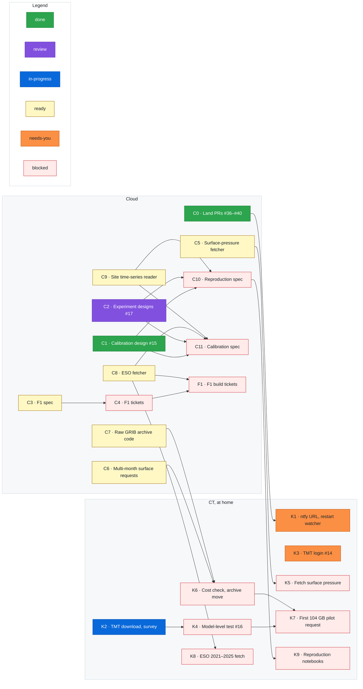

# Roadmap: status, work order and session prompts

**This is the single source for what runs next, where it runs, and the prompt that starts it.** It is a living document: every session updates it as it starts and finishes, following [`docs/agents/session-handoff.md`](agents/session-handoff.md). Status changes are committed straight to `dev` (D67); everything else changes through pull requests.

- Decisions live in `docs/decisions.md`.
- Ticket discussions live in GitHub issues under the two maps:
  - [Map #6: the way to Gate 1](https://github.com/rrweller/Astro-seeing/issues/6) (historical track)
  - [Map #20: the way to F1](https://github.com/rrweller/Astro-seeing/issues/20) (forecast track)

## How to use it

1. Look at the **status board** below (or the colored diagram). Anything `ready` can start now. Items in the same wave can run at the same time.
2. Open the item's section under **Prompts**. Start a new cloud session on `rrweller/Astro-seeing` (`cloud` items) or a Claude Code session on CT 350 (`CT` items). Choose the model and effort shown, and paste the whole prompt as your first message. Many prompts begin with a slash command such as `/mattpocock-skills:grill-with-docs`. Keep it as the very first thing in the message: that's what starts the skill, and the rest of the prompt goes to it as its instructions (see the skills guide).
3. The session marks the item `in-progress`, then `review` when its PR is open. After you merge the PR, it marks the item `done` and moves the items that were waiting on it to `ready`. If a session ends early, the next session's sweep catches up.
4. `needs-you` means the item is waiting on you: a merge, a login, an approval, or being at home.

## Status board

Each line: ID · **state** · where it runs · item · tickets and PRs. Sessions edit only the state word and the link, per `docs/agents/session-handoff.md`; the blank lines between entries are deliberate.

- `C0` · **done** · cloud · Land the open PRs #36–#40 into `dev` · [#36](https://github.com/rrweller/Astro-seeing/pull/36) [#37](https://github.com/rrweller/Astro-seeing/pull/37) [#38](https://github.com/rrweller/Astro-seeing/pull/38) [#39](https://github.com/rrweller/Astro-seeing/pull/39) [#40](https://github.com/rrweller/Astro-seeing/pull/40)

- `C1` · **done** · cloud · Calibration design (grilling, needs you) · [#15](https://github.com/rrweller/Astro-seeing/issues/15) [#44](https://github.com/rrweller/Astro-seeing/pull/44)

- `C2` · **review** · cloud · Experiment designs (grilling, needs you) · [#17](https://github.com/rrweller/Astro-seeing/issues/17) [#45](https://github.com/rrweller/Astro-seeing/pull/45)

- `C3` · **ready** · cloud · F1 spec (needs your approval) · ticket: none yet

- `C4` · **blocked** · cloud · F1 build tickets from the spec · ticket: none yet

- `C5` · **ready** · cloud · Surface-pressure point fetcher for Haslebacher (b) · ticket: none yet

- `C6` · **ready** · cloud · Multi-month surface requests and per-kind planning rates · ticket: none yet

- `C7` · **ready** · cloud · Code to move the kept raw GRIB to the NAS · ticket: none yet

- `C8` · **ready** · cloud · ESO seeing-monitor fetcher · ticket: none yet

- `C9` · **ready** · cloud · Site time-series reader for the reproductions · ticket: none yet

- `C10` · **blocked** · cloud · Reproduction spec and CT tickets (needs your approval) · ticket: none yet

- `C11` · **blocked** · cloud · Calibration spec and CT tickets (needs your approval) · ticket: none yet

- `F1` · **blocked** · cloud + CT · F1 build tickets (C4 lists them here) · ticket: none yet

- `K1` · **needs-you** · CT · Recover the ntfy URL; pull `dev` and restart the notify watcher · needs you: be at home

- `K2` · **in-progress** · CT · TMT ERA5 download finishing (~28–29 Nov), then survey the stores · download running

- `K3` · **needs-you** · CT · TMT login · [#14](https://github.com/rrweller/Astro-seeing/issues/14)

- `K4` · **blocked** · CT · One model-level (ERA5 complete) test request · [#16](https://github.com/rrweller/Astro-seeing/issues/16)

- `K5` · **blocked** · CT · Fetch surface pressure at the 8 Haslebacher sites · ticket: none yet

- `K6` · **blocked** · CT · Surface-request cost check, then the raw GRIB archive move · ticket: none yet

- `K7` · **blocked** · CT · First pilot request: 1–16 June 2023, global, ~104 GB · ticket: none yet

- `K8` · **blocked** · CT · ESO DIMM/MASS fetch for 2021–2025 · ticket: none yet

- `K9` · **blocked** · CT · Reproduction notebooks, one per paper · ticket: none yet

## Dependency diagram

Colors show each item's state (legend at the bottom). The arrows show what has to finish first.



In the diagram, the class names are `done`, `review`, `inprogress`, `ready`, `needsyou` and `blocked`. Mermaid class names can't contain hyphens, so `in-progress` is written `inprogress` and `needs-you` is written `needsyou`.

## Work order

### Cloud waves

Items in a wave can run at the same time. A later wave usually depends on an earlier one, or is simply lower priority.

**Practical limit:** you can answer only one grilling session at a time. Coding sessions run on their own, but keep to about three at once so their PRs don't conflict much. The "Touches" column shows which ones overlap.

The Skills column puts the slash command the prompt starts with in **bold**; the rest are skills the session loads by itself.

| Wave | ID | Model / effort | Needs you? | Skills | Touches |
|---|---|---|---|---|---|
| 1 | C0 | Sonnet 5.5 / low | yes: you merge each PR in the GitHub app | code-review, resolving-merge-conflicts | `docs/decisions.md`, `notify.py` |
| 1 | C1 | Opus 5.5 / high | yes: grilling | **/grill-with-docs** (grilling + domain-modeling) | `docs/decisions.md`, `CONTEXT.md` |
| 1 | C5 | Sonnet 5.5 / high | no | **/implement** (tdd, then code-review) | `download/`, `cli.py` |
| 1 | C8 | Sonnet 5.5 / high | no | **/implement** (tdd, then code-review) | new module, `cli.py` |
| 1 | C9 | Opus 5.5 / high | no | **/implement** (tdd, then code-review), codebase-design first | new module |
| 2 | C2 | Opus 5.5 / high | yes: grilling | **/grill-with-docs** (grilling + domain-modeling) | `docs/decisions.md` |
| 2 | C3 | Opus 5.5 / high | yes: approve the spec | **/to-spec**, codebase-design, grilling (gaps only), domain-modeling | issues, `docs/decisions.md` |
| 2 | C6 | Sonnet 5.5 / high | no | **/implement** (tdd, then code-review) | `download/requests.py`, `configs/era5.yaml`, `cli.py` |
| 2 | C7 | Sonnet 5.5 / high | no | **/implement** (tdd, then code-review) | `manifest.py`, `cli.py`, new module |
| 3 | C4 | Opus 5.5 / medium | yes: approve the ticket list | **/to-tickets**, codebase-design, writing-for-agents | issues, this file |
| 3 | C10 | Opus 5.5 / high | yes: approve | **/to-spec**, then you send **/to-tickets**; grilling, domain-modeling, writing-for-agents | issues, this file |
| 3 | C11 | Opus 5.5 / high | yes: approve | **/to-spec**, then you send **/to-tickets**; codebase-design, domain-modeling, writing-for-agents | issues, this file |
| 3 | F1 | per ticket ("Suggested model" line) | per ticket | per ticket (usually **/implement**) | per ticket |

### CT order

Copernicus allows **one job at a time per account** (D39). So the items that use it run strictly one after another:

1. K2 (the TMT queue, running now);
2. K4;
3. K7.

Items that don't use that slot can run alongside them: K5 uses its own time-series slot, and K6's cost estimates submit nothing.

| ID | Depends on | Uses the CDS slot? | Model / effort | Skills |
|---|---|---|---|---|
| K1 | C0 for the restart part | no | you, or Sonnet 5.5 / low | `mattpocock-skills:wizard` if you want a step-by-step script for the restart; otherwise none |
| K2 | — | yes (running now) | Sonnet 5.5 / medium for the survey | none (a survey and short report) |
| K3 | — | no | you | `mattpocock-skills:wizard` to walk you through registering and saving the credentials file |
| K4 | K2 | **yes** | Sonnet 5.5 / high | `mattpocock-skills:research` to write up what the measurement shows |
| K5 | C5 | own slot | Sonnet 5.5 / medium | none (runs C5's command) |
| K6 | C6, C7 | estimates only | Sonnet 5.5 / high | none (runs C6's and C7's commands, dry run first) |
| K7 | K4, K6 | **yes** | Opus 5.5 / high (it measures several unknowns) | `mattpocock-skills:research` to write up what the test request measured |
| K8 | C8 | no | Sonnet 5.5 / medium | none (runs C8's command) |
| K9 | C10, C9 | no | Opus 5.5 / high; escalate a hard mismatch to Fable 5.2 / high | **`/mattpocock-skills:implement`** per ticket; `mattpocock-skills:diagnosing-bugs` when a reproduction misses its tolerance |

The CT items rarely need a slash command, because their work is running commands that cloud items already built. Whether the Matt Pocock plugin is installed in Claude Code on the CT hasn't been checked. Before the first CT item that uses a skill, run `/mattpocock-skills:ask-matt` there: if the CT answers "unknown command", the plugin needs installing.

## Model and effort guide

Relative API prices per million input/output tokens (cached 2026-11-03): Haiku 5.5 $0.10/$0.50, Sonnet 5.5 $2/$10, Opus 5.5 $4/$20, Fable 5.2 $8/$40. Usage credits should scale in roughly the same proportion, but how Riley's plan counts them hasn't been checked.

| Kind of work | Model | Effort | Why |
|---|---|---|---|
| Design decisions with physics or validation consequences (grilling), specs | **Opus 5.5** | high | Wrong choices here propagate into every result. These sessions are short and mostly conversation. |
| Well-specified code with tests, where the decision is already written down | **Sonnet 5.5** | high | The design is fixed by a D-number, so the work is careful implementation. Data-safety code stays at high. |
| Small mechanical work (merging branches, append-only conflicts, config) | **Sonnet 5.5** | low–medium | Cheap, but still follows AGENTS.md's rules reliably. |
| Code implementing physics or interpolation used for Gate 1 numbers | **Opus 5.5** | high | Subtle mistakes there would silently shift the reproductions. |
| Diagnosing a reproduction that misses its tolerance for no obvious reason | **Fable 5.2** | high | The one place where the 2× price over Opus is likely worth it, and only after an Opus session has tried. |
| Haiku 5.5 | not recommended | — | Every session must follow AGENTS.md's strict data-safety and provenance rules. |

These are judgment calls, not measurements. If a Sonnet session struggles, rerun the item on Opus.

## Skills guide

The Matt Pocock skills (plugin `mattpocock-skills`) come in two kinds:
- **Slash-command skills** are the workflows. Only you can start them, by typing the slash command at the very start of a message. A session can't load them itself, and they don't appear in its skill list. That's why #42 wrongly thought they weren't installed.
- **Session skills** are the building blocks. The session loads them itself when the prompt names them.

Each prompt below starts with at most one slash command (a message can only start one), and its `Skills:` line names the session skills.

**Slash-command skills** (type the command first; the rest of the message goes to the skill):

| Command | What it does | Use it for |
|---|---|---|
| `/mattpocock-skills:grill-with-docs` | Loads `grilling` and `domain-modeling`: a one-question-at-a-time interview that writes glossary terms and decisions as it goes | Decision tickets (C1, C2) |
| `/mattpocock-skills:to-spec` | Turns what the session knows into a spec issue (template: problem, solution, user stories, implementation and testing decisions, out of scope), after checking the test seams with you. It doesn't interview | Specs (C3, C10) |
| `/mattpocock-skills:to-tickets` | Cuts a spec into tracer-bullet tickets with "Blocked by" edges, shows you the list to approve, then creates the issues | Ticket lists (C4, C10's second step) |
| `/mattpocock-skills:implement` | Builds the work its prompt or ticket describes: test-first with `tdd` at agreed seams, the full suite at the end, then `code-review`, then a commit | Code items (C5–C9, F1 and K9 tickets) |
| `/mattpocock-skills:triage` | Moves issues through the triage labels in `docs/agents/triage-labels.md`, and writes agent-ready briefs | Sorting new issues; no roadmap item yet |
| `/mattpocock-skills:wayfinder` | Plans a body of work too big for one session as a map issue of decision tickets (how maps #6 and #20 were made) | A new track; no roadmap item yet |
| `/mattpocock-skills:improve-codebase-architecture` | Scans for deepening opportunities, makes an HTML report, then grills you through one | Optional refactoring passes |
| `/mattpocock-skills:ask-matt` | Asks which skill fits a situation | When unsure which skill to use |

**Session skills** (named on each prompt's `Skills:` line as `mattpocock-skills:<name>`):

| Skill | Use it for |
|---|---|
| `grilling` | Question-and-answer design sessions with Riley (decision tickets) |
| `domain-modeling` | Glossary terms in `CONTEXT.md`, and decisions in `docs/decisions.md` (never `docs/adr/`) |
| `codebase-design` | Shaping module interfaces before building, and cutting specs into tickets along module boundaries |
| `tdd` | Building code test-first |
| `code-review` | Reviewing a branch against `origin/dev` before opening its PR, or reviewing someone else's PR |
| `diagnosing-bugs` | A failing test or a reproduction that misses its tolerance |
| `research` | Writing up findings from primary sources, or from a measurement, as a Markdown note |
| `prototype` | Throwaway prototypes that answer a design question |
| `resolving-merge-conflicts` | Merging `dev` into a branch that conflicts |
| `wizard` | A step-by-step script for something only Riley can do (logins, credentials) |
| `writing-for-agents` | Writing prompts for new roadmap items, or editing `CLAUDE.md` |

**Where the skills and these docs differ**, the docs win:
- **Decisions:** "ADR" means a D-number in `docs/decisions.md` (`docs/agents/domain.md`).
- **Issues:** issues follow `docs/agents/issue-tracker.md`. In the cloud, a `Blocked by:` line in the body is the source of truth, plus a `runs-on:*` label.
- **Pull requests:** every item still ends with a PR into `dev` and the status steps in `docs/agents/session-handoff.md`, even where a skill says only "commit".

## Reserved D-numbers

Parallel sessions would otherwise take the same number.

| D-number | Item |
|---|---|
| D58 | C1 |
| D59 | C2 |
| D60 | C3 |
| D61 | C10 |
| D62 | C5 |
| D63 | C6 |
| D64 | C7 |
| D65 | C8 |
| D66 | C9 |
| D68 | C11 |

- D67 is this roadmap process.
- A session needing more than one number adds letters (D62a, D62b, …).
- New items take the next free number after the highest on `dev`, in open PRs, and in this table, and add it to this table in their PR.

---

## Prompts

Every prompt has the same first sentence, which loads the session protocol. Most put a slash command in front of it on the same line, which starts that item's main skill. Copy everything inside the box and send it as one message. If a session ever shows the skill without the rest of the prompt (it shouldn't), send the prompt again without the slash command as the next message.

### C0. Land the open PRs #36–#40

Sonnet 5.5, low effort. Needs you to merge. Skills: `mattpocock-skills:code-review` (PR #36's code), `mattpocock-skills:resolving-merge-conflicts` (each branch update).

```text
Read docs/agents/session-handoff.md on origin/dev first and follow it for this whole session. Your roadmap item is C0.

Skills: use mattpocock-skills:code-review to review PR #36's code, and mattpocock-skills:resolving-merge-conflicts each time you merge dev into the next PR's branch.

You are a cloud session on rrweller/Astro-seeing. Read AGENTS.md and CLAUDE.md. Never push to main.

Task: help Riley land the five open PRs into dev, in D-number order: #36 (D53, stall alert), #38 (D54, Paranal comparison), #37 (D55, global downloads), #40 (D56, globe library), #39 (D57, reproduction settings). Each appends to docs/decisions.md, so after one merges the next conflicts there.

1. Review #36's code change (src/astroseeing/notify.py, tests/test_notify.py) against D53, and run its tests (pixi run pytest tests/test_notify.py, or python -m pytest if pixi is missing). Report findings briefly. The other four are documentation of decisions Riley already agreed; check only that each merges cleanly.
2. Set C0 to needs-you ("needs you: merge #36"), tell Riley which PR to merge, and subscribe to that PR's activity.
3. After each merge: fetch origin/dev, merge it into the next PR's branch, and resolve docs/decisions.md by keeping both entries in D-number order (D67 may already be on dev; keep it last). Push to that PR's branch (never force-push), update the needs-you note, and tell Riley it's ready.
4. When all five are merged: set C0 to done, sweep, and comment one line on map #6 and map #20 saying D53–D57 are on dev.

Do not change any decision's content. If a conflict is more than an append, stop and ask Riley.
```

### C1. Calibration design, ticket #15

Opus 5.5, high effort. Needs you (grilling). Starts with `/mattpocock-skills:grill-with-docs` (it loads `grilling` and `domain-modeling`).

```text
/mattpocock-skills:grill-with-docs Read docs/agents/session-handoff.md on origin/dev first and follow it for this whole session. Your roadmap item is C1.

Skills: this message starts grill-with-docs, which loads mattpocock-skills:grilling (run the session with it) and mattpocock-skills:domain-modeling (the glossary in CONTEXT.md, and the decision entry: a D-number in docs/decisions.md, not an ADR).

You are a cloud session on rrweller/Astro-seeing (no /data, CDS or CT access). Work from origin/dev. Read AGENTS.md, CLAUDE.md, CONTEXT.md, docs/agents/issue-tracker.md and docs/RESEARCH.md in full (§4.8 calibration, §6 targets). If D54 and D57 aren't on dev yet, read docs/decisions.md from branches planning/paranal-comparison-d54 (PR #38) and grill/7-reproductions (PR #39). Also read reports/validation_downloads.md and docs/research/seeing-measurements.md (branch research/seeing-measurements).

Task: resolve ticket #15, "Calibration design: what's fitted, on which data, and what's held out", as a grilling session with Riley. Claim the ticket. Work one question at a time, and recommend an answer with evidence for each. Cover at least:
- which quantity is fitted (K in J or a seeing scale), and whether the free atmosphere and ground layer are fitted separately where MASS exists;
- which data: ESO Paranal/La Silla DIMM+MASS 2021–2025 (stored ERA5: Chile area, night hours) and TMT 2006–2007 (5 sites; login pending, #14);
- the hold-out: which years and/or sites, and why;
- the matching rules (hour windows, nightly medians, minimum samples); reuse D54's where they fit and say where the historical track differs;
- the acceptance numbers: D19's bias limits (≤0.10″ free atmosphere, ≤0.15″ total), plus which other statistics are reported;
- how calibration interacts with the ground-layer experiment (#17) and with the reproductions (each paper's own constants first).

When agreed:
- write D58 in docs/decisions.md and add new terms to CONTEXT.md;
- comment the answer on #15 and close it;
- add a one-line gist with a link under "Decisions so far" in map #6;
- open a PR into dev.

Verify any link before citing it. Say plainly when unsure.
```

### C2. Experiment designs, ticket #17

Opus 5.5, high effort. Needs you (grilling). Starts with `/mattpocock-skills:grill-with-docs` (it loads `grilling` and `domain-modeling`).

```text
/mattpocock-skills:grill-with-docs Read docs/agents/session-handoff.md on origin/dev first and follow it for this whole session. Your roadmap item is C2.

Skills: this message starts grill-with-docs, which loads mattpocock-skills:grilling (run the session with it) and mattpocock-skills:domain-modeling (the glossary in CONTEXT.md, and the decision entry: a D-number in docs/decisions.md, not an ADR).

You are a cloud session on rrweller/Astro-seeing (no /data, CDS or CT access). Work from origin/dev. Read AGENTS.md (Phase 1 step 5 lists the experiments), CLAUDE.md, CONTEXT.md, docs/agents/issue-tracker.md, docs/RESEARCH.md in full (§5 terrain method, §4.7 ground layer, §4.2 cloud), and docs/decisions.md entries D5, D6, D7, D19, D31, D36, D55, D57 and D58 if present (read unmerged ones from their open PR branches). Also read reports/cds_throughput_one_job.md for what downloads cost.

Task: resolve ticket #17, "Experiment designs: sites, periods, metrics, and the downloads they need", as a grilling session with Riley. Claim the ticket. The five experiments are:
- pressure vs model levels;
- terrain-aware vs cell average;
- cloud above height vs total cloud, including the D6 overlap-rule check;
- hourly vs 3-hourly;
- ground-layer options: none, O&S relocation, W71, calibrated constant.

For each one, agree on:
- sites and periods, using data already on the NAS wherever possible;
- the metric, and what result would change the method;
- any new download, sized in fields and in days at one CDS job at a time (~4 h queue wait per request);
- its order relative to the reproductions and calibration.

Any download over 50 GB or 24 h is an [ASK]: list it with its size. When agreed:
- write D59;
- comment on #17 and close it;
- update map #6's "Decisions so far";
- add any new CT work as new roadmap items (with prompts) in your PR;
- open a PR into dev.

Verify links; say when unsure.
```

### C3. F1 spec

Opus 5.5, high effort. Needs your approval. Starts with `/mattpocock-skills:to-spec`. Session skills: `mattpocock-skills:codebase-design`, `mattpocock-skills:grilling` (gaps only), `mattpocock-skills:domain-modeling`.

```text
/mattpocock-skills:to-spec Read docs/agents/session-handoff.md on origin/dev first and follow it for this whole session. Your roadmap item is C3.

Skills: this message starts to-spec. Use its spec template and its seam check with Riley. It says not to interview; here, ask Riley only about real gaps in the decisions, using mattpocock-skills:grilling. Use mattpocock-skills:codebase-design to shape the spec's modules, interfaces and test seams, and mattpocock-skills:domain-modeling for any new glossary terms. Read everything listed below before you start writing: to-spec synthesises what you know, so the reading is its input.

You are a cloud session on rrweller/Astro-seeing (no /data, CDS or CT access). Work from origin/dev. Read:
- AGENTS.md (forecast track milestones), CLAUDE.md, CONTEXT.md, docs/agents/issue-tracker.md, docs/RESEARCH.md;
- every forecast decision D43–D56 in docs/decisions.md (if D53–D56 aren't on dev yet, read them from the branches of PRs #36, #37, #38 and #40);
- map #20 and the research notes it links (branches research/forecast-sources, research/seeing-measurements, research/valley-fog);
- the prototype on branch prototype/forecast-views.

Task: write the F1 spec as a GitHub issue under map #20, in to-spec's template (labels runs-on:cloud and ready-for-agent; follow docs/agents/issue-tracker.md). Put its link on your roadmap board line. The spec turns the decisions into buildable parts, each with interfaces and an acceptance test:
- fetchers for GFS, ICON-EU, MEPS and IFS;
- verification and the manifest tables;
- physics reuse (both Cn² models, J above the observer, H̄);
- per-place stores and expiring SSD products;
- the tonight summary and verdict rules (D48);
- the data files and page (D52), the MapLibre map (D56), the alerts (D51), and the Paranal comparison (D54).

The spec must also:
- reuse the ESO fetcher from roadmap item C8, not specify a second one;
- say which parts run in the cloud and which on the CT;
- fix the formats D52 left open (per-place JSON, map-layer binaries, latest.json).

Don't re-decide anything already decided. Where the decisions leave a real gap, ask Riley one question at a time with a recommendation, and record the answers as D60. Show Riley the spec outline for approval (set C3 to needs-you while you wait). Then open a PR into dev for any doc changes.
```

### C4. F1 tickets

Opus 5.5, medium effort. Needs your approval. Starts with `/mattpocock-skills:to-tickets`. Session skills: `mattpocock-skills:codebase-design`, `mattpocock-skills:writing-for-agents` (for the new prompts).

```text
/mattpocock-skills:to-tickets Read docs/agents/session-handoff.md on origin/dev first and follow it for this whole session. Your roadmap item is C4. The spec is the approved F1 spec issue under map #20.

Skills: this message starts to-tickets. Use its tracer-bullet slicing, its approval quiz with Riley and its issue template, plus the extra lines below. Use mattpocock-skills:codebase-design to cut tickets along module boundaries (so parallel tickets touch different files), and mattpocock-skills:writing-for-agents when writing the per-ticket prompts for docs/roadmap.md.

You are a cloud session on rrweller/Astro-seeing. Work from origin/dev. Read AGENTS.md, CLAUDE.md, CONTEXT.md, docs/agents/issue-tracker.md, docs/roadmap.md, and the approved F1 spec issue under map #20 with its comments.

Task: break the F1 spec into build tickets as sub-issues of map #20 (follow docs/agents/issue-tracker.md). Each ticket has:
- "Part of #20" and a "Blocked by:" line;
- one runs-on label;
- an acceptance test;
- a "Suggested model:" line from the model guide in docs/roadmap.md (Sonnet 5.5 high for specified code; Opus 5.5 high for physics, the verdict rules and the Paranal statistics);
- a "Suggested skills:" line from the skills guide in docs/roadmap.md (for code, usually "start with /mattpocock-skills:implement", which runs tdd and then code-review);
- a "Can run alongside:" line naming tickets that touch different files.

Order them so a working end-to-end slice (one model, one place, page shows data) lands first. Show Riley the list for approval before creating the issues (set C4 to needs-you while you wait).

Then, in a PR into dev, replace roadmap item F1 with one item per ticket. Each item gets:
- an ID F1-1, F1-2, …;
- a board line with the ticket link;
- a diagram node, its edges and a class line followed by a %% --- spacer;
- a section with model and effort, suggested skills, and a short self-contained prompt. The prompt starts with the ticket's slash command (usually /mattpocock-skills:implement) followed on the same line by this prompt's standard first sentence, then has a "Skills:" line, and says "work ticket #N".

The Blocked by line in each ticket body is the source of truth (docs/agents/issue-tracker.md), even where to-tickets would use native blocking links. Don't close or change map #20 except to add the tickets as sub-issues.
```

### C5. Surface-pressure point fetcher for Haslebacher (b)

Sonnet 5.5, high effort. Starts with `/mattpocock-skills:implement` (test-first with `tdd`, then `code-review`).

```text
/mattpocock-skills:implement Read docs/agents/session-handoff.md on origin/dev first and follow it for this whole session. Your roadmap item is C5.

Skills: this message starts implement, and this prompt is its spec. Build test-first with mattpocock-skills:tdd, then run mattpocock-skills:code-review on your branch against origin/dev before opening the PR, and fix what it finds. Implement ends with a commit; this item still ends with the PR and status steps below.

You are a cloud session on rrweller/Astro-seeing (no /data, CDS or CT access). Work from origin/dev. Read AGENTS.md, CLAUDE.md, docs/agents/issue-tracker.md, docs/RESEARCH.md §3.4 and §7 (the single-level time-series product), and decisions D2, D25, D29, D39 and D57 item 4 (if D57 isn't on dev, read it from branch grill/7-reproductions, PR #39).

Task: build a minimal point fetcher for the CDS product reanalysis-era5-single-levels-timeseries that gets surface pressure (sp) at given points for 1979–2020 (D57 item 4). First create a ticket under map #6 (labels runs-on:cloud, wayfinder:task), unless one exists, claim it, and put its link on your roadmap board line.

Requirements:
- Use the existing ecmwf-datastores client pattern (D2) and the manifest, so requests are tracked and resumable.
- The product has its own CDS slot (D29). Its jobs are recorded, but never counted by or blocking the pressure-level gate (D39).
- Chunk by year if a request limit bites; the chunk size is configurable, because the 42-year single request is untested.
- Verify the returned NetCDF: variable, point, time coverage, no gaps or NaN (count and log any).
- Write atomically as a small per-site store under a path from config.
- Add a CLI command and tests against tests/fakes.py, covering a resubmitted lost job, a partial year, and a verification failure.
- Use the 8 Haslebacher sites' nearest grid points from configs/sites.yaml.

Don't contact the CDS from this session. Log non-trivial choices as D62. Run the full test suite and ruff, then open a PR into dev with the exact CT commands for Riley.
```

### C6. Multi-month surface requests and per-kind planning rates

Sonnet 5.5, high effort. Starts with `/mattpocock-skills:implement` (test-first with `tdd`, then `code-review`).

```text
/mattpocock-skills:implement Read docs/agents/session-handoff.md on origin/dev first and follow it for this whole session. Your roadmap item is C6.

Skills: this message starts implement, and this prompt is its spec. Build test-first with mattpocock-skills:tdd, then run mattpocock-skills:code-review on your branch against origin/dev before opening the PR, and fix what it finds. Implement ends with a commit; this item still ends with the PR and status steps below.

You are a cloud session on rrweller/Astro-seeing (no /data, CDS or CT access). Work from origin/dev. Read AGENTS.md, CLAUDE.md, docs/agents/issue-tracker.md, reports/cds_throughput_one_job.md, and decisions D16, D23, D39, D40 and D55 (if D55 isn't on dev, read it from branch grill/13-global-downloads, PR #37).

Task (D55 item 5, plus the config fix in cds_throughput_one_job.md §5). First create a ticket under map #6 (runs-on:cloud, wayfinder:task), unless one exists, claim it, and put its link on your roadmap board line.

1. Let single-level requests span up to N consecutive months (configurable, default 3, per D55) in src/astroseeing/download/requests.py; RequestSpec.cds_request allows one month today.
   - A months × days request implies dates that don't exist (30 Feb, 31 Apr), and verification must expect exactly the real dates.
   - Planning refuses anything over the configured cost limit before queuing.
   - Labels and store paths stay unique.
2. Add a command (or flag) that prices a plan with the CDS cost estimator without submitting it, printing the estimate next to our own field count, so Riley can run the "does the CDS count 30 February?" check on the CT.
3. Replace the single request.fields_per_s in configs/era5.yaml with per-kind planning rates from the report, or better, the per-request wait-plus-run model (W + F/R, §5). Update the estimate plan-area prints.

Pressure-level requests stay unchanged. Tests: month boundaries, leap years, non-existent dates, cost limit, unique keys, estimates. Log non-trivial choices as D63. Run the full test suite and ruff, then open a PR into dev with the CT commands for the cost check.
```

### C7. Code to move the kept raw GRIB from `/staging` to the NAS

Sonnet 5.5, high effort. Starts with `/mattpocock-skills:implement` (test-first with `tdd`, then `code-review`).

```text
/mattpocock-skills:implement Read docs/agents/session-handoff.md on origin/dev first and follow it for this whole session. Your roadmap item is C7.

Skills: this message starts implement, and this prompt is its spec. Implement ends with a commit; this item still ends with the PR and status steps below. Build test-first with mattpocock-skills:tdd (write the crash-recovery and hung-filesystem tests first), then run mattpocock-skills:code-review on your branch against origin/dev before opening the PR, and fix what it finds. This code deletes files, so take the review seriously.

You are a cloud session on rrweller/Astro-seeing (no /data, CDS or CT access). Work from origin/dev. Read AGENTS.md in full (data-safety rules), CLAUDE.md, docs/agents/issue-tracker.md, and decisions D10, D11, D12, D50 and D55 items 6–7 (if D55 isn't on dev, read it from branch grill/13-global-downloads, PR #37).

Task: build the command that copies the raw validation GRIB kept on /staging (~41 GB, 472 files, plus the 271 MB measurement file) to a write-once archive on the NAS, then removes the /staging copies. First create a ticket under map #6 (runs-on:cloud, wayfinder:task), unless one exists, claim it, and put its link on your roadmap board line.

Rules:
- The archive path comes from config (D55 suggests /data/astro/raw-archive; propose the exact layout).
- Order of operations: copy, fsync, verify the SHA-256 against the manifest's recorded checksum, record the archive location in the manifest, and only then delete the /staging copy. Mirror D12's ordering and crash recovery.
- Never overwrite or delete anything under /data. A destination with different content is refused; an identical one is a no-op.
- Add a dry-run mode that prints sizes and the plan.
- NFS hangs rather than failing (AGENTS.md), so use per-file timeouts and a watchdog.
- Make it resumable after interruption.
- Measurement-only files (state "measured") are listed separately, because deleting them is Riley's call.

Tests with temp directories and a fake slow or hung filesystem. Log non-trivial choices as D64. Run the full test suite and ruff, then open a PR into dev with the exact CT commands (dry run first).
```

### C8. ESO seeing-monitor fetcher

Sonnet 5.5, high effort. Starts with `/mattpocock-skills:implement` (test-first with `tdd`, then `code-review`).

```text
/mattpocock-skills:implement Read docs/agents/session-handoff.md on origin/dev first and follow it for this whole session. Your roadmap item is C8.

Skills: this message starts implement, and this prompt is its spec. Build test-first with mattpocock-skills:tdd, then run mattpocock-skills:code-review on your branch against origin/dev before opening the PR, and fix what it finds. Implement ends with a commit; this item still ends with the PR and status steps below.

You are a cloud session on rrweller/Astro-seeing (no /data, CDS or CT access). Work from origin/dev. Read AGENTS.md, CLAUDE.md, docs/agents/issue-tracker.md, docs/RESEARCH.md §6.5, decisions D28, D44 and D54 item 8 (if D54 isn't on dev, read it from branch planning/paranal-comparison-d54, PR #38), and docs/research/seeing-measurements.md on branch research/seeing-measurements (ESO query details).

Task: one fetcher for ESO's ambient-conditions archive, shared by the forecast track (nightly, D54 item 8) and the historical calibration (2021–2025 bulk). First create a ticket under map #20 (runs-on:cloud, wayfinder:task), unless one exists, claim it, and put its link on your roadmap board line.

Requirements:
- Data: Paranal DIMM and MASS (including free-atmosphere seeing, turbulence altitude and ground fraction), and La Silla DIMM.
- Query by UTC time range. Use a generic User-Agent with no contact details. In bulk mode, send at most one request every few seconds, chunked by month.
- Write raw CSV write-once under a configured path (D54: /data/astro/validation/eso-asm/), with fetch time and SHA-256, recorded in the manifest.
- A re-fetch of the same night is a separate, named file (D54's 3-day re-fetch). Never overwrite.
- Parse into a typed table. Count and log rows dropped as missing or non-numeric; never clip.

If this session can reach archive.eso.org, save one small real response as a test fixture (CC BY 4.0; note the ESO acknowledgement) and check the column names against it. Otherwise build from the documented columns and say so in the PR. Tests: parsing, write-once, re-fetch naming, retries. Log choices as D65. Run the full test suite and ruff, then open a PR into dev with the CT commands for the 2021–2025 bulk fetch.
```

### C9. Site time-series reader for the reproductions

Opus 5.5, high effort. Starts with `/mattpocock-skills:implement` (test-first with `tdd`, then `code-review`). Session skill: `mattpocock-skills:codebase-design` first.

```text
/mattpocock-skills:implement Read docs/agents/session-handoff.md on origin/dev first and follow it for this whole session. Your roadmap item is C9.

Skills: this message starts implement, and this prompt is its spec. Implement ends with a commit; this item still ends with the PR and status steps below. Before any code, design the reader's interface and test seams with mattpocock-skills:codebase-design (one deep module the four notebooks call). Then build it with mattpocock-skills:tdd at those seams, and run mattpocock-skills:code-review on your branch against origin/dev before opening the PR, and fix what it finds.

You are a cloud session on rrweller/Astro-seeing (no /data, CDS or CT access). Work from origin/dev. Read AGENTS.md, CLAUDE.md, CONTEXT.md, docs/agents/issue-tracker.md, docs/RESEARCH.md in full, decisions D3, D5, D8, D10, D18 and D57 (if D57 isn't on dev, read it from branch grill/7-reproductions, PR #39), and reports/validation_downloads.md §1 (store layouts: grid, and area cells).

Task: the shared, tested code the four paper reproductions will call on the CT. Map #6 says the cloud writes this against synthetic stores. First create a ticket under map #6 (runs-on:cloud, wayfinder:task), unless one exists, claim it, and put its link on your roadmap board line.

1. Read a site's hourly columns (z, t, u, v, and cc when present) from one or many Zarr stores in either layout, over a time range, in time order, with checks for duplicate or missing hours.
2. Site-value rules (D57 item 2):
   - nearest grid point;
   - four-point bilinear (O&S);
   - Priyatikanto's cubic interpolation in lon, lat and pressure, then linear to 5 hPa steps.
   Interpolating T, u, v and z is allowed inside reproductions; interpolating seeing or J is not.
3. Underground-level masking by the cell's static orography (D57 item 1), plus the unmasked variant. Masked counts are returned, not just logged.
4. Hour-set selectors (D57 item 3), using the existing solar module:
   - all hours;
   - night mask (Sun < −12°);
   - dark time (Sun < −18°) over a given list of nights;
   - local-solar-time windows (04–07 h, 19–23 h).
5. Golden-result JSON helpers (D57 item 5: settings, store ids and content hashes, statistics, target, tolerance, gating vs informational), and a pytest marker `data` that skips when /data is absent.

Build synthetic test stores with the existing synthetic helpers. Known-answer tests for each interpolation; property tests where they fit. Log choices as D66. Run the full test suite and ruff, then open a PR into dev.
```

### C10. Reproduction spec and CT tickets

Opus 5.5, high effort. Needs your approval. Two slash commands in one session: the prompt starts with `/mattpocock-skills:to-spec`, and once you've approved the spec, the session asks you to send `/mattpocock-skills:to-tickets #<spec issue>` as your next message. Session skills: `mattpocock-skills:grilling` (the open question), `mattpocock-skills:domain-modeling`, `mattpocock-skills:writing-for-agents` (the new prompts).

```text
/mattpocock-skills:to-spec Read docs/agents/session-handoff.md on origin/dev first and follow it for this whole session. Your roadmap item is C10.

Skills: this message starts to-spec. Write the reproduction spec in its template and check its seams with Riley. A session can't start to-tickets itself, so once Riley approves the spec, ask Riley to send "/mattpocock-skills:to-tickets #<spec issue number>" as the next message. Then cut the tickets with it, using the extra ticket lines below. Use mattpocock-skills:grilling for the open question about missed tolerances, mattpocock-skills:domain-modeling for terms and the decision entry, and mattpocock-skills:writing-for-agents when writing the per-ticket prompts for docs/roadmap.md.

You are a cloud session on rrweller/Astro-seeing. Work from origin/dev. Read:
- AGENTS.md, CLAUDE.md, CONTEXT.md, docs/agents/issue-tracker.md, docs/roadmap.md, docs/RESEARCH.md in full;
- decisions D19, D27, D28, D35, D57, D58 and D59;
- the research notes on branches research/os2018-nights and research/bi2023-altitudes;
- the merged code from roadmap items C9 (site reader) and C5 (surface-pressure fetcher).

Task: write the reproduction spec as an issue under map #6, then its tickets (follow docs/agents/issue-tracker.md).
- Create one runs-on:ct ticket per paper, in D57's order: Haslebacher (a) Paranal, Priyatikanto, Bi, O&S. Add Haslebacher (b) (Table 4 levels) and Haslebacher (c) (the written account).
- Each ticket states:
  - the variant grid fixed before running;
  - the gating variant and its tolerance (D19);
  - the input store ids;
  - the outputs: notebook, reports/repro_<paper>.md, golden JSON;
  - "Suggested model: Opus 5.5 high" and "Suggested skills: start with /mattpocock-skills:implement; mattpocock-skills:diagnosing-bugs if a result misses its tolerance; mattpocock-skills:research for the written account".
- Reuse existing tickets rather than duplicating them.
- Include what happens when a reproduction misses its tolerance, as an open question for Riley with a recommendation (map #6 lists it as unspecified).

Show Riley the outline and ticket list for approval (C10 to needs-you while you wait). Record decisions as D61. In a PR into dev, replace roadmap item K9 with one item per ticket (K9a, K9b, …), each with a board line, diagram node, edges, a class line followed by a %% --- spacer, and a short prompt. The prompt starts with "/mattpocock-skills:implement" followed on the same line by this prompt's standard first sentence (with the new ID), then has a "Skills:" line.

The Blocked by line in each ticket body is the source of truth (docs/agents/issue-tracker.md). Don't close or change map #6 except to add the spec and tickets as sub-issues.
```

### C11. Calibration spec and CT tickets

Opus 5.5, high effort. Needs your approval. Like C10: the prompt starts with `/mattpocock-skills:to-spec`, and once you've approved the spec, the session asks you to send `/mattpocock-skills:to-tickets #<spec issue>` as your next message. Depends on C1 (D58), C2 (D59, the ground-layer experiment is calibration's stage 2), C8 (the ESO fetcher the data comes from) and C9 (the site reader the matching code uses).

```text
/mattpocock-skills:to-spec Read docs/agents/session-handoff.md on origin/dev first and follow it for this whole session. Your roadmap item is C11.

Skills: this message starts to-spec. Write the calibration spec in its template and check its seams with Riley. A session can't start to-tickets itself, so once Riley approves the spec, ask Riley to send "/mattpocock-skills:to-tickets #<spec issue number>" as the next message. Use mattpocock-skills:codebase-design for the fit module's interface, mattpocock-skills:domain-modeling for terms (CONTEXT.md: Fit set, Held-out set, Freeze, Matched hour, MASS seeing, Ground-layer term) and the decision entry, and mattpocock-skills:writing-for-agents for the per-ticket prompts.

You are a cloud session on rrweller/Astro-seeing. Work from origin/dev. Read AGENTS.md, CLAUDE.md, CONTEXT.md, docs/agents/issue-tracker.md, docs/roadmap.md and docs/RESEARCH.md in full; decisions D19, D54, D57, D58 and D59; src/astroseeing/physics/calibration.py; and the merged code from C8 (ESO fetcher) and C9 (site reader).

Task: write the calibration spec (D58) as an issue under map #6, then its tickets (follow docs/agents/issue-tracker.md). At least:
- a runs-on:cloud ticket for the matching code (D58 item 6: hour medians, matched hours, nightly medians, counts and reasons), against synthetic data;
- a runs-on:cloud ticket for the committed split file and the fit (items 4–5: equal-site-weight zero-bias root find, G >= 0 logged, 7-night block bootstrap, the refusal of held-out nights with its unit test);
- a runs-on:ct ticket for the TMT fetcher and first-data checks (cadence, time standard, normalisation, instrument heights; the 20% rule), blocked by #14;
- runs-on:ct tickets for the stage-1 fit, the stage-2 fits per ground-layer option with cross-validation (shared with #17's ground-layer experiment; reuse its ticket if one exists), and the single held-out run after the freeze, which is blocked by the four reproduction tickets and by Riley's ground-layer [ASK];
- reports/calibration.md's contents (item 8's gated checks and reported statistics).

Show Riley the outline and ticket list for approval (C11 to needs-you while you wait). Record any decisions as D68. In a PR into dev, add one roadmap item per CT ticket (next free K numbers), each with a board line, diagram node, edges, a class line followed by a %% --- spacer, and a short prompt starting with "/mattpocock-skills:implement" followed on the same line by this prompt's standard first sentence (with the new ID), then a "Skills:" line.

The Blocked by line in each ticket body is the source of truth (docs/agents/issue-tracker.md). Don't close or change map #6 except to add the spec and tickets as sub-issues.
```

### CT prompt template (K2, K4–K9)

Model, effort and skills are in the CT order table above. Replace `<ID>` and the task line. If the item's skills start with a **bold** slash command (K9's tickets: `/mattpocock-skills:implement`), put it before the first word, on the same line; otherwise delete `<slash command>`.

```text
<slash command> Read docs/agents/session-handoff.md on origin/dev first and follow it for this whole session. Your roadmap item is <ID>.

You are a Claude Code session on CT 350 (/home/astro-seeing), with /data, /staging, the manifest and CDS access. Read AGENTS.md, CLAUDE.md, docs/ct_runbook.md and docs/handoff_pivot.md §1. Run git fetch origin and check out dev at origin/dev. Check `pixi run astro status` and `systemctl status astro-boxes`: only one CDS job may be queued or running per account (D39), and nothing may bypass that gate.

Skills: <the session skills listed for this item in the CT order table, or "none">.

Task: <the item's line from the status board, or "work ticket #N">. Follow the ticket's acceptance test if there is one. Data-safety rules apply in full:
- never overwrite or delete under /data without asking Riley;
- verify before deleting raw files;
- write a short report in reports/ with the numbers and what is uncertain;
- log non-trivial decisions as the next free D-number.
Open a PR into dev when done.
```
