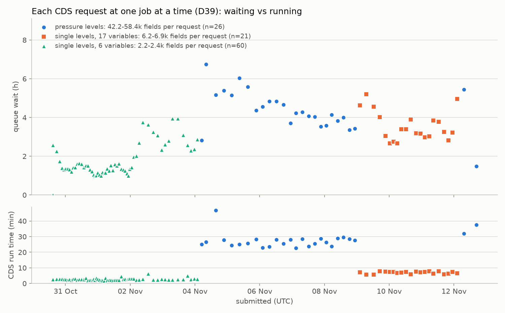

# CDS throughput at one job at a time (#11, throughput part)

Ticket #11 (part of map #6). This covers the throughput part only. The global-hour test waits for the measurement-only mode (#10, PR #32), and so does restating the phase 2 and 3 estimates in `reports/validation_downloads.md` §4.

- **Measured on:** the CT, 2026-11-12. The data come from a read-only copy of the manifest taken with the SQLite backup API at 21:34:52 UTC. The live manifest was not written.
- **Script:** `scripts/cds_throughput.py`.
- **Figure:** `reports/figures/cds_throughput_one_job.png`.

## Summary

- **Waiting, not processing, is the cost.** Over 107 requests (1.50 M fields, 30 Oct to 12 Nov) the median request waited 2.7 h in the CDS queue and then ran for 3.1 min. Running took 5.5% of the time from submit to finish: 2.5–3.2% for single-level requests, 9–14% for pressure-level ones.
- **Pressure levels: 2.66 fields/s**, averaged over the 4 full days that ran only pressure levels (5–8 Nov; daily 2.13–3.19). That is about a quarter of September's 10.3 fields/s with up to 4 jobs in flight. It is also half the 5.6 fields/s that `configs/era5.yaml` (`request.fields_per_s`) uses for planning estimates.
- **Single levels are lower: 0.36 fields/s** for Chile's 6-variable subset (4 full days, 31 Oct–3 Nov; daily 0.22–0.49), and **0.58 fields/s** for the 17-variable set (2 full days, 10–11 Nov). The requests are small (2,400 and 6,900 fields), but each one still waits hours.
- **Processing rate once a job runs:** about 29 fields/s for pressure levels and 15–17 fields/s for single levels. For single levels the run time is linear in fields with almost no fixed cost: 22 s + fields ÷ 17 fields/s, r = 0.94. The area makes no difference: a 5 × 5 box ran at 27 fields/s and the 38 × 16 Chile area at 29.
- **The queue wait follows the CDS's load more than request size.**
  - Same-sized requests (2,184–2,418 fields, Chile's 6-variable subset) waited a median of 75–81 min on 31 Oct and 1 Nov, but 162 min on 2 and 3 Nov.
  - Since 7 Nov, ~45,000-field pressure-level requests waited a median of 4.0 h, and 6,900-field single-level ones 3.25 h.
- **So bigger requests are cheaper per field.** A wait of hours per request against ~29 fields/s of processing means each request should be as close to the CDS cost limit as possible.
- **Nothing went wrong at the CDS.** There were 0 rejections, 0 pauses and 0 lost jobs, and never two jobs at once (D39 held). Every request's field count matched its GRIB message count at verification.
- **Our side costs almost nothing:** a median of 18 s from one job finishing to the next submission. The only real loss was a CT outage on 12 Nov, which left the slot unused for 3.2 h.

## 1. Method

- **The copy:** taken with the SQLite backup API from the live manifest opened read-only (`mode=ro`) at 2026-11-12 21:34:52 UTC; `integrity_check` returned ok.
- **Which requests:** every request whose `cds_finished_at` falls between 2026-10-30 00:00 and the copy. That is 107 requests, each with one file, all downloaded, verified and ingested.
  - The request still at the CDS (`pl/tmt_spm/2006-03`, submitted 18:37 UTC) is left out.
- **Timestamps:**
  - `cds_started_at` and `cds_finished_at` are the CDS's own job timestamps (the client's `started_at` and `finished_at`).
  - `submitted_at` is the CT's clock, which is synchronised. So the queue wait also includes the submit call itself, about 1 s.
- **Definitions:**
  - **Queue wait** = `cds_started_at − submitted_at`.
  - **Run time** = `cds_finished_at − cds_started_at`.
  - **Slot time** = `cds_finished_at − submitted_at`, the time a request held the account's one place at the CDS (D39).
  - **Idle** = this request's `submitted_at` minus the previous job's `cds_finished_at`.
- **Fields:** the CDS cost computed from `request_json` (variables × levels × hours × days, `notify.request_fields`). For all 107 requests it equals the GRIB message count found at verification.
- **Days:**
  - Each request counts on the UTC day its CDS job finished.
  - A full day is one the loop ran from start to end: 31 Oct to 11 Nov, 12 days.
  - With 4–6 pressure-level requests a day, one request more or less moves that day's rate by about ±0.5 fields/s. The means over several days are therefore the numbers to use.
- **To reproduce:** `pixi run python scripts/cds_throughput.py COPY.sqlite --since 2026-10-30 --until 2026-11-12T21:34:52Z --plot reports/figures/cds_throughput_one_job.png`. Any manifest export from the 13 Nov 03:17 UTC run onward (`/data/astro/manifest-exports/`) should give the same numbers with these flags.

## 2. Queue wait and run time per request group

| Group | Requests | Fields per request | Queue wait, median | p10–p90 | min–max | Run time, median | p10–p90 | Running, share of slot time | Fields/s while running (median) | Fields/s over slot time |
|---|---|---|---|---|---|---|---|---|---|---|
| `pl/chile` 2006–07 (z t u v, 13 h) | 24 | 42,224–46,748 | **255 min** | 208–332 | 169–405 | 26.4 min | 23.6–28.9 | 9.3% | 29 | 2.61 |
| `pl/tmt_spm` (z t u v cc, 13 h) | 2 | 52,780; 58,435 | 89 and 327 min | — | — | 37.7 and 32.0 min | — | 14.4% | 27 | 3.82 |
| `sl/chile` 2006–07 (17 variables) | 21 | 6,851 max | **195 min** | 165–278 | 160–312 | 7.2 min | 5.9–7.7 | 3.2% | 15 | 0.51 |
| `sl/chile@vars-…` 2021–25 (6 variables) | 60 | 2,418 max | **85 min** | 63–185 | 0.7–237 | 2.6 min | 2.1–3.2 | 2.5% | 15 | 0.36 |
| all | 107 | | **162 min** | 70–284 | 0.7–405 | 3.1 min | 2.2–27.9 | 5.5% | 17 | 1.33 |

- **Shortest waits:** apart from the first request (39 s, submitted by hand on 30 Oct after 5.6 days with no CDS jobs), no request waited less than 59 min.
- **Longest wait:** 6.75 h, for `pl/chile/2006-02`, submitted at 08:14 on 4 Nov, the second request after the TMT release.

The top panel is the queue wait per request against submit time; the bottom panel is the CDS run time. Each colour is one kind of request (legend). The two panels have different units: hours on top, minutes below.

## 3. Per day

| Day (UTC) | What ran | Requests | Fields | Fields/s over the day | Fields/s while running | Queue wait, median | Notes |
|---|---|---|---|---|---|---|---|
| 30 Oct (from 14:36) | sl, 6 variables | 5 | 11,778 | partial | 14 | 104 min | loop started 14:40 |
| 31 Oct | sl, 6 variables | 18 | 42,744 | 0.49 | 15 | 81 min | |
| 1 Nov | sl, 6 variables | 18 | 42,744 | 0.49 | 16 | 75 min | |
| 2 Nov | sl, 6 variables | 9 | 21,294 | 0.25 | 13 | 162 min | same requests, wait doubled |
| 3 Nov | sl, 6 variables | 8 | 19,110 | 0.22 | 14 | 162 min | |
| 4 Nov | sl, 6 variables (2), then pl (3) | 5 | 140,478 | 1.63 | pl 23, sl 14 | 172 min | Chile subset done 04:44; TMT released 05:00 (16 min idle) |
| 5 Nov | pl | 4 | 183,976 | **2.13** | 30 | 330 min | |
| 6 Nov | pl | 5 | 230,724 | **2.67** | 30 | 280 min | two clean CT halts, 12:23–14:14; no CDS time lost |
| 7 Nov | pl | 5 | 227,708 | **2.64** | 30 | 244 min | |
| 8 Nov | pl | 6 | 275,964 | **3.19** | 28 | 223 min | |
| 9 Nov | pl (1), then sl, 17 variables (4) | 5 | 73,268 | 0.85 | pl 28, sl 17 | 273 min | |
| 10 Nov | sl, 17 variables | 8 | 53,703 | 0.62 | 16 | 187 min | |
| 11 Nov | sl, 17 variables | 7 | 47,294 | 0.55 | 16 | 190 min | |
| 12 Nov (to 21:35) | sl, 17 variables (2), pl (2) | 4 | 124,696 | partial | pl 27, sl 16 | 245 min | CT down 12:10–16:31, unclean stop; 3.2 h of slot time lost |

**Averages over full days:**

| Kind | Days | Fields | Fields/s |
|---|---|---|---|
| Pressure levels (z t u v, ~45,000 per request) | 5–8 Nov (4) | 918,372 | **2.66** (daily 2.13–3.19) |
| Single levels, 6 variables (2,418 per request) | 31 Oct–3 Nov (4) | 125,892 | **0.36** (daily 0.22–0.49) |
| Single levels, 17 variables (6,851 per request) | 10–11 Nov (2) | 100,997 | **0.58** (daily 0.55–0.62) |
| Everything, mixed | 31 Oct–11 Nov (12) | 1,359,007 | 1.31 |

## 4. Other observations

- **Time of day.** By UTC hour of submission, the median queue wait was 139 min for 18–24, 158 for 00–06, 195 for 12–18 and 215 for 06–12, from 22–30 requests each.
  - This hints that European working hours are busier.
  - But the mix of request kinds differs between those slots, so it is weak evidence.
- **Idle before a submission.** All three submissions that followed a stretch with no job at the CDS got the shortest wait of their kind:
  - 30 Oct, after 5.6 days: 39 s;
  - 4 Nov, after 16 min (waiting for the TMT release): 169 min, the shortest of the 24 `pl/chile` waits;
  - 12 Nov, after 3.2 h (the CT outage): 89 min, the shortest pressure-level wait.

  Every other submission came within a minute of the previous job finishing. This fits a CDS priority that drops with an account's recent use. But it is only three cases, and I have not found ECMWF documentation describing such a rule, so treat it as a lead, not a finding.
- **Downloads.** In total, 1.84 GB took 4.1 min, which is negligible next to the queue waits.
  - The rate grows with file size, because small files are dominated by latency: the 62 MB pressure-level files came at a median of 21 MB/s (max 25.6), and the 3 MB single-level files at 2.3 MB/s.
  - September's transfers reached 21–47 MB/s. This month's files are too small to show the top rate; the global hour (~300 MB) will.
- **Our side.**
  - Idle time per submission: median 18 s and p90 30 s (the downloader polls every 30 s).
  - In total, 4.0 h idle over the 13 days: 3.2 h of it the 12 Nov outage, and 0.27 h waiting for the hourly TMT release check on 4 Nov.
  - The two clean CT halts on 6 Nov cost nothing, because the job was still queued at the CDS and the restarted loop picked it up.

## 5. What this means, short of the phase 2/3 estimates

- **Time per request.** At one job at a time, a request takes about **W + F ÷ R**:
  - W is the queue wait: medians between 1.3 h and 5.5 h depending on the day;
  - F is the request's fields;
  - R is the processing rate: ~29 fields/s for pressure levels, ~17 for single levels.
  
  For example, a pressure-level request of 58,000 fields with a 4 h wait takes 4.6 h, or 3.5 fields/s. The phase 2/3 estimates need both W and R. The global-hour test will give R for global fields and the transfer rate, but its queue wait is only one more sample of W.
- **Request size.** Requests should be as large as the cost limit allows. For single levels, that probably means merging variables, months or areas up to the 121,000-field limit, if verification and the manifest can handle larger requests (D16, D23).
- **The planning rate in config is optimistic.** `configs/era5.yaml` `request.fields_per_s: 5.6` is about twice the measured pressure-level rate (2.66). It only feeds the estimate that `plan-area` prints. Not changed here; a small ticket could set it from these numbers, ideally per kind.
- **The stall alert fires on normal waits.** Its 3 h threshold is below the median pressure-level wait (4.3 h), so it fired 36 times between 4 and 12 Nov without anything being wrong (status comment on #11, 2026-11-12).

## 6. What's uncertain

- **The CDS's load is invisible to us.** It changed from one day to the next: the median wait for identical requests doubled overnight on 1–2 Nov. These 13 days are one sample of it; re-measure before any large campaign.
- **Request size and load are confounded.** Pressure and single levels ran in different weeks, except around 9 and 12 Nov. The comparison since 7 Nov (pressure levels 4.0 h, single levels 3.25 h) is the cleanest available, and still only 11 against 21 requests.
- **Small samples:**
  - `pl/tmt_spm` has only 2 requests.
  - The 17-variable single levels have 2 full days, below the 3 days asked for. Counting the 6-variable subset, single levels have 6 full days in all.
- **Per-day noise:** each request counts on the day it finished, so pressure-level days carry ±0.5 fields/s of rounding.
- **Cost limits not re-measured.** The ticket also asks for the per-request cost limits in force. This session sent nothing to the CDS, so they weren't re-measured. What the data do show:
  - pressure-level requests of up to 58,435 fields were accepted throughout, under the configured 60,000 (measured 2026-09-27);
  - no single-level request came near the 121,000 limit.

## 7. Not in this report

- The global hour of 29 levels × 5 variables: it needs PR #32 merged (#10).
- Restating the phase 2 and 3 download estimates (`reports/validation_downloads.md` §4) with these numbers: that waits for the global hour.
